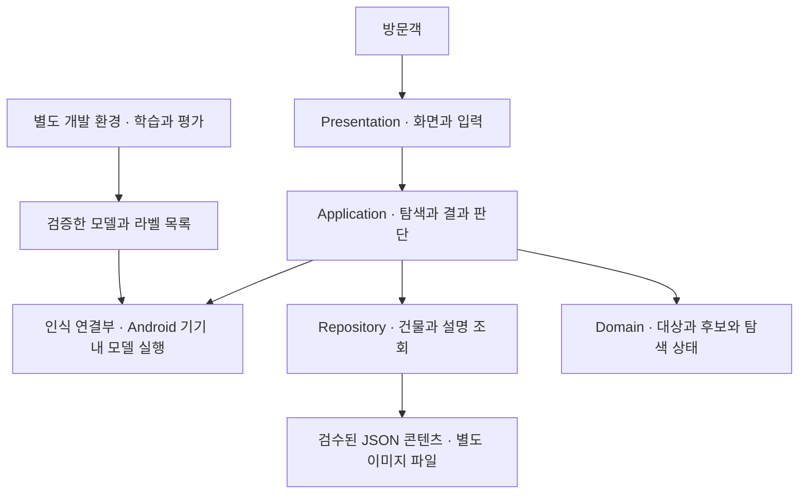
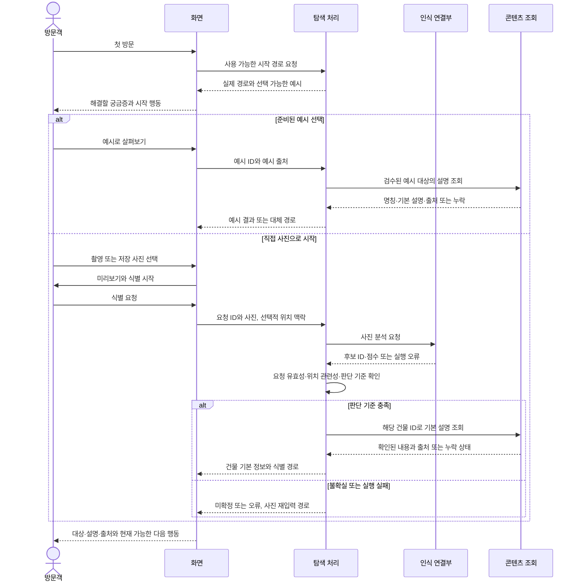

# 구조와 데이터 흐름

상태: 프로토타입의 구현 구조와 실제 제품의 설계 초안을 구분한다. 제품 초안은 수업 자료 「07_시스템구조설계 및 개발환경」과 「양식 6 시스템 구조 설계 및 개발 환경」을 따른다. 2026-10-24 사용자가 설치형 Android 앱과 기기 내 추론 우선 방향, TypeScript + React Native + Expo의 시작 구성을 선택했다. 후속 대안 조사·2단계 설계 검수로 데이터/입출력을 구체화하고 Expo SDK 57 Development Build를 첫 연결 실험 기준으로 선정했다. 모델·추론 런타임은 미선정이며 패키지 조합의 실제 빌드·성능 검증 완료를 뜻하지 않는다.

## 실제 제품 구조 초안 — 양식 6

설계·실험 근거와 후속 Android 실행의 진행 상태는 [Sprint 0 이슈](https://github.com/HyunKN/visual-travel-guide/issues/21)에서 관리한다. 기존 프로토타입 종료와 제품 실행 완료를 구분한다.

수업 PDF p.3의 0~5절 구성, p.8~12의 책임·핵심 흐름·데이터/API, p.13~14의 환경·추적성을 따른다. 아래 Mermaid가 수정 가능한 다이어그램 원본이다. 제출 Word 작성 시 양식의 표지·개정 이력·본문 8쪽 내외 조건을 적용하고 개인정보는 비공개 제출본에만 넣는다. 이 초안은 공개 가능한 기술 내용이며 제출 완료 기록이 아니다.

### 0. Meta Information

| 항목 | 초안 |
| --- | --- |
| Project | 궁금한 궁 · Visual Travel Guide |
| Team | 1인 수행, PO·SM·Dev 역할. 개인 식별 정보는 비공개 제출본에 기재 |
| Version | 설계 초안 0.7 · 2026-10-24 · 데이터·입출력 대안 조사와 2단계 설계 검수, 구현·모델 연동 검증 예정 |
| Framework | TypeScript 6.0.3 + React Native 0.86.3 + React 19.2.3 + Expo 57.0.31을 첫 Android Development Build 기준으로 선정. 실제 설치·lockfile·빌드 검증 전. 기존 웹 프로토타입은 Vanilla JavaScript + Vite |
| Scope | [4차 Product Backlog](PRODUCT_BACKLOG_DRAFT.md)의 US-01~12 연결. Must 10개와 후순위 Should 2개의 기존 배치 유지 |

**2026-10-24 선택 경과:** 사용자가 제시한 TypeScript + React Native + Expo를 처음부터 채택으로 해석하지 않고 [실제 개발 사례·네이티브 추론 연동 조사](experiments/react-native-adoption-research.md)를 수행했다. 이후 온디바이스 AI 자체와 연동 라이브러리의 호환 위험을 구분해 설명한 뒤, 사용자가 이 구성으로 먼저 진행하는 데 동의했다. 채택 범위는 시작 구성과 작은 Android 연결 실험이며 ONNX 제품 채택·특정 버전·성능은 확정하지 않았다. Expo 설정 문제와 React Native 공통 초기화 문제를 구분하고, 해결 비용이 크면 해당 연결 방식을 재검토한다.

### 1. Project Overview

경복궁 자유 관람객이 이름을 모르는 건물을 사진으로 확인하고, 이름·위치 같은 단서로 탐색하며 출처 있는 설명을 확인하는 제품을 만든다. 처음 진입했을 때 받을 도움과 시작 행동을 이해하고, 결과가 불확실하면 판단을 보류한 채 다시 탐색할 수 있게 한다. 모델을 직접 학습·개선하는 기술 목표와 방문객에게 유용한지 확인하는 제품 목표를 함께 다룬다.

- **현재 개발 계획:** US-01~10의 첫 진입·사진 입력·건물 식별·검색·지도·후보 비교·재탐색·기본/맥락 설명·탐색 복귀. US-11의 준비된 질문과 US-12의 사전 지정 부분 탐색은 Should·미배치다.
- **확장 검토:** 새 사진에서 누른 부위의 자동 식별, 잡상 무리만 보이는 사진의 종류 식별. 대화에서 논의한 요구이며 기존 범위에 채택된 기능은 아니다. 종류를 알아보는 것과 어느 건물의 어느 부위인지 특정하는 것은 구분한다. 잡상 개별 형상 식별은 이번 논의의 목표가 아니다.
- **제외 범위:** 현재 백로그 §5를 유지한다. 자유 질문 LLM·RAG, 자동 코스 최적화, 전국 지원, 상세 3D 등을 이 설계에서 추가하지 않는다.

| 성공 지표 | 기존 목표 | 검증 조건 |
| --- | --- | --- |
| 건물 식별 | Top-1 ≥80%, Top-3 ≥90% | 학습에 사용하지 않은 촬영 조건별 사진, 사진 단독과 위치 결합을 각각 평가 |
| 탐색 과제 성공 | ≥85% | 올바른 대상 설명 도달, 도움·실패 구분 |
| 설명 도달 시간 | 기존 지도·검색 대비 평균 ≥30% 단축 | 난이도·순서 통제, 실패율 함께 기록 |
| 현장 유용성 | 5점 평균 ≥4.0 | 현장 평가·인터뷰. 소수 모의 관찰과 구분 |

위 수치는 백로그의 목표를 옮겼으며 달성 결과가 아니다. 무료 AI·검색과 비교할 때 질문 작성·재질문·잘못된 설명·첫 접속 부담도 함께 확인한다. 전용 흐름이 수고를 줄인다는 것은 가설이다. AI 비교의 최소 개선 기준은 기준선 과업을 정할 때 본 평가 전에 합의하며 위 기존 목표를 대체하지 않는다. 이번 구조 문서 작성 자체에는 새 사용자 실험을 요구하지 않는다.

### 2. Architecture Design

#### 2.1 논리 구조와 책임

입출력, 업무 판단, 데이터 접근, 핵심 상태를 분리한다. 아래는 설치형 Android 앱 내부의 책임 경계다. 모델은 기기 안에서 실행하는 방향을 우선 채택하고 교체 가능한 연결부로 둔다. 수업의 Spring Boot는 예시이므로 그 이유만으로 도입하지 않는다.

**2026-10-24 사용자 결정:** 서버 운영보다 설치형 앱 개발을 우선하고 TypeScript + React Native + Expo로 시작한다. 기존 모바일 웹은 프로토타입과 관찰 기록으로 유지한다. 초기 검수 콘텐츠는 앱에 포함한 JSON, 이미지·모델은 별도 파일로 둔다(§3.1). 초기 콘텐츠 갱신은 앱 배포에 포함하며 원격 동기화는 채택하지 않는다. 완전 오프라인 동작, 모델을 설치 파일에 포함할지 최초 실행 때 내려받을지는 미정이다. 정적 파일 배포와 서버에서 사진을 계산하는 것은 구분한다. 기기 내 실행이 요구를 충족하지 못하면 입력 크기·모델·지원 범위를 먼저 재검토하고, 서버 전송은 사용자와 다시 결정한다.

선택 이유는 서버 운영을 먼저 구축하지 않고 Android 기기에서 핵심 인식 흐름을 검증하기 위해서다. 설치 부담이 첫 사용 진입에 미치는 영향, 모델 적재·추론 시간·메모리·지원 밖 입력·취소/재입력을 실제 기기에서 확인한다. 설치형이라는 이유만으로 기존 검색·AI보다 유용하다고 판단하지 않는다.



| 책임 | 해야 할 일 | 하지 않을 일 |
| --- | --- | --- |
| Presentation | 도움·행동·결과의 연결, 실제 경로/예시 구분, 사진 미리보기·권한·오류/복귀 표시 | 모델 점수를 직접 정답으로 결정하거나 역사 설명 생성 |
| Application | 사용 가능한 시작 경로 결정·예시/실제 입력 분리·요청 취소·후보 판단·위치 조건·설명 조회·복원 | 화면 객체나 특정 모델 라이브러리에 업무 규칙 종속 |
| Repository | 같은 대상 ID의 콘텐츠·출처·참고 사진·구역 및 검수된 예시 조회 | 예시 조회를 모델 인식으로 처리하거나 정답 판정 |
| Domain | 건물·부분·후보·입력/결과의 출처·선택 경로·식별 상태·데이터 관계 표현 | HTTP·DB·화면 프레임워크 의존 |
| 인식 연결부 | 입력 전처리·추론·모델 라벨을 건물 ID로 변환·실행 오류 전달 | 등록되지 않은 건물 ID나 근거 없는 신뢰도 백분율 반환 |
| 학습·평가 환경 | 학습/검증/최종 평가 분리·모델 개선·실기기용 산출물 확인 | 사용자 입력 사진을 자동 학습 자료로 수집 |

#### 2.2 핵심 흐름 1 — 첫 진입에서 첫 유용한 결과까지

US-01·04·05·08, Sprint 1의 첫 흐름이다. 사진을 고르기 전 **앱이 무엇을 도와주는지 이해하고 스스로 시작하는 과정**부터 설계한다. 첫 유용한 결과는 단순히 결과 화면이 열린 상태가 아니라, 사용자가 고른 대상에 맞는 확인된 설명을 읽고 자신의 궁금증에 답이 됐는지 판단할 수 있는 상태다. 실제 해소 여부는 사람 관찰로 확인한다.

아래는 검토할 동작 초안이다. 별도 온보딩 화면·상황 설문·3D·튜토리얼을 필수로 추가하지 않는다. [첫 진입 화면 원칙](DESIGN.md#실제-제품의-첫-진입과-첫-결과-설계-초안)을 따르며 시각 배치는 사용자 검토 후 정한다.

| 사용자의 상황·행동 | 화면에서 얻을 단서·결과 | 내부 처리·실패 시 경로 |
| --- | --- | --- |
| 처음 앱을 열고 쓸모를 판단 | 건물 사진·대표 궁금증·결과를 드러내는 행동 이름으로 무엇을 알아볼 수 있는지 파악 | Application이 현재 제공 가능한 경로와 예시를 구분. 홈 열람에 카메라·위치 권한이나 모델 적재 완료를 요구하지 않음 |
| 눈앞 건물 또는 저장 사진으로 시작 | 사진 촬영/선택 → 미리보기 → 식별 시작 | 해당 행동에서만 필요한 권한 요청. 취소·거부 시 사진 선택 또는 시작 화면으로 복귀 |
| 방문 전이거나 아직 입력할 사진이 없음 | 선택적인 ‘예시로 살펴보기’에서 준비된 건물 설명 확인 | 검수된 예시를 같은 설명 조회 경로로 연결. 예시임을 진입·결과에서 유지하고 모델 호출·가짜 분석 대기 없음 |
| 건물 이름을 알고 있음 | 이름 검색으로 시작할 수 있음 | US-02 구현 이후 노출. 제품에서 아직 없는 검색·지도를 프로토타입에 있다는 이유로 제공 중처럼 표시하지 않음 |
| 첫 결과를 읽음 | 대상 명칭·짧은 기본 설명·출처. 어떤 질문에 답하는지 입력 대상과 연결 | 예시·실제 사진 결과·사용자 선택의 출처를 보존. 불확실하면 §2.3, 자료가 없으면 확인된 내용만 표시 |
| 더 궁금하거나 결과가 맞지 않음 | 사용 가능한 새 사진 입력·예시에서 실제 탐색·이전 화면 복귀 | 현재 제공되는 행동만 연결. 상세 검색/지도 복귀·맥락 해설은 기존 Sprint 2 배치 유지 |

예를 들어 ‘이 건물은 어떤 곳일까?’로 시작했는데 첫 결과가 건물 이름만 보여주면 부분 충족이다. 역사·관람 포인트를 약속하려면 해당 검수 콘텐츠와 US-09가 실제 제공되는 단계여야 한다. 부위 자동 인식을 지원하기 전에는 ‘사진의 아무 곳이나 누르면 설명’을 약속하지 않는다.



위치가 거부·부정확·미취득이면 사진 단독으로 진행한다. 저장 사진과 현재 위치의 관련성이 확인되지 않으면 보정에 사용하지 않는다. 위치만으로 사진 후보를 무조건 제외하지 않는다. 결과 기준·위치 관련성 판정 방법·대기 제한값은 PoC에서 결정한다. 사진 A 분석 중 B를 선택하거나 취소하면 A의 늦은 결과가 B 화면을 덮지 않아야 한다.

**근거와 남은 가설:** [기존 UX 조사](PRODUCT_BACKLOG_DRAFT.md#부록-a-첫-유용한-결과를-위한-조사와-적용-후보)의 2026-10-17 기록을 사용했다. Apple 지침은 짧고 맥락에 맞는 안내, Google Lens의 기록된 절차는 행동과 결과의 연결을 참고하게 한다. 반면 Stoiber 등의 연구는 튜토리얼의 무조건적 효과를 뒷받침하지 않는다. 관광앱·우리 Android 화면의 효과 증거는 아니며 최신 기업 UI를 이번에 새로 조사한 것도 아니다. 적용 가설은 소개를 더 읽게 하기보다 한 번의 실제 탐색 또는 명시된 예시로 도움을 판단하게 하면 시작 부담이 줄어든다는 것이다. [첫 진입 검증](QUALITY.md#첫-진입과-첫-유용한-결과-검증)에서 반례까지 확인한다.

#### 2.3 핵심 흐름 2 — 불확실한 결과에서 재탐색

| 단계 | 주체 | 처리 | Story |
| --- | --- | --- | --- |
| 1 | Application | 실행 오류와 낮은 신뢰도를 구분. Sprint 1에는 미확정·재입력 제공 | US-05 |
| 2 | Application → Repository | Sprint 2에서 비교할 후보의 참고 사진·구별 근거 조회 | US-06 |
| 3 | Presentation | 입력 사진과 후보 자료를 구분. 판단 보류·해당 없음 제공 | US-06·07 |
| 4 | 방문객 → Application | 후보를 선택하면 선택 경로를 기록하고 같은 ID로 설명 조회. AI가 정답을 검증했다고 표시하지 않음 | US-06·08 |
| 5 | Application | 거부·새 탐색이면 이전 선택을 무효화. 구현된 재촬영·사진 선택·이름·지도 경로로 이동 | US-07·10 |

#### 2.4 핵심 흐름 3 — 이름·지도에서 설명과 관람으로

| 단계 | 주체 | 처리 | Story |
| --- | --- | --- | --- |
| 1 | 방문객 → Presentation | 이름 검색 또는 지도·구역 선택. 위치 없이 구역 직접 선택 가능 | US-02·03 |
| 2 | Application → Repository | 지원 건물 목록·명칭·대표 사진·위치 조회. 범위 밖과 결과 없음 구분 | US-02·03 |
| 3 | Application → Repository | 선택 ID로 기본 정보·맥락 해설·출처 조회 | US-08·09 |
| 4 | Presentation | 이름·역사·관람 포인트를 필요한 순서로 표시. 준비된 관련 질문은 후순위 지원 시 연결 | US-09·11 |
| 5 | Application | 이전 검색어·구역·사진·선택·스크롤 복원 또는 새 탐색 시작 | US-10 |

US-12는 등록 사진의 지원 영역을 고르면 연결된 부분 ID로 설명을 조회한다. 이 좌표를 사용자 촬영 사진에 그대로 적용하지 않는다. 사진 확대와 페이지 스크롤의 충돌·하단 탐색바 가림은 [DESIGN](DESIGN.md)의 보완 기준으로 검증한다. 첫 진입은 소개 문구를 늘리기보다 도움·행동·결과의 관계가 보이는 배치를 검토한다.

### 3. 데이터와 API 설계 초안

#### 3.1 데이터 관계와 무결성

**2026-10-24 채택한 저장 방식:** 초기 제품의 검수 콘텐츠는 앱에 포함한 JSON으로 읽고 이미지와 AI 모델은 별도 파일로 둔다. 현재 소규모·읽기 중심 범위에서 DB 초기화·마이그레이션 부담을 줄이기 위한 선택이다. SQLite나 서버 DB는 초기 구성에 도입하지 않는다. 이는 설계 결정이며 Android 제품 저장소 구현·성능 검증 완료가 아니다.

| 자료 | 저장·사용 기준 |
| --- | --- |
| 건물·별칭·구역·검수 좌표, 설명·출처·이용 조건 | 버전 관리하는 JSON. ID로 연결하여 조회 |
| 관련 질문·부분·등록 사진의 지원 영역·시작 예시 | 지원 범위의 JSON 참조. Should 항목의 구현 시점은 기존 백로그를 유지 |
| 대표 사진·비교 사진·썸네일 | 별도 이미지 파일. JSON에는 자산 참조와 메타데이터만 보관 |
| 모델·라벨 대응·전처리 설정 | 모델은 별도 파일, 라벨/대상 ID 대응과 설정은 버전 관리. 모델 전달 방식·런타임은 별도 결정 |
| 사용자 입력 사진·검색어·선택·인식 결과·관련 위치 | 현재 탐색에 필요한 임시 파일/메모리 상태. 영구 기록·학습 재사용은 기본으로 하지 않음 |

조회 흐름은 **인식 후보 또는 사용자 선택의 대상 ID → Repository가 JSON에서 설명·출처·사진 참조 조회 → 화면 표시**다. 이름·별칭·구역 탐색도 같은 콘텐츠를 조회한다. 화면은 저장 파일을 직접 조합하지 않고 §3.2의 조회 책임을 사용한다. [데이터·입출력 상세 설계](experiments/form6-data-contract-review.md)에 대안 비교, 필드·필수값·버전·파일 역할, 1차 요구사항 대조와 2차 반례 검수를 기록했다. 스키마·Repository 구현과 실기기 검증은 아직 없다.

선정한 세부 방식은 **단일 JSON 묶음의 종류별 배열+ID 참조, 작은 로컬 Repository, 개발용 Zod 스키마와 참조/자산 검사, 이미지 ID의 정적 require 매핑**이다. 타입만으로 실행 중 자료의 유효성을 보장하지 않는다. JSON은 한 번 읽어 ID 조회표를 만들고 이미지·모델 바이트는 분리한다. 이미지 표시와 모델 적재는 필요한 흐름에서 수행한다.

배포 전 검사에서 중복 ID, 잘못된 참조, 필수 설명의 출처 누락, 이미지 파일 누락, 모델 라벨과 대상 ID 불일치를 잡도록 한다. 이 검사는 제품 콘텐츠용으로 구현·실행해야 하며 기존 프로토타입 검사 통과로 대체하지 않는다. 자료 누락 시 다른 대상 설명을 대신 보여주지 않는다.

**절충과 재검토 조건:** JSON은 트랜잭션·인덱스·관계 제약을 제공하지 않아 참조 검사와 검색 처리를 코드로 구현해야 한다. 빈번한 부분 갱신, 복잡한 조건 검색, 지속적인 사용자 기록이 실제 요구가 되거나 측정한 적재 시간·메모리가 허용 기준을 넘으면 SQLite를 재검토한다. JSON이 SQLite보다 항상 빠르거나 작다는 측정 근거는 없다. SQLite로 변경할 때도 데이터 이전·검증 작업은 필요하다. 초기 콘텐츠 갱신은 앱 배포에 포함한다. 앱 소유 임시 사본은 탐색 이력·진행 중 네이티브 작업에서 더 이상 참조하지 않을 때 정리하고, 다음 실행에서 이전 세션 잔여 파일을 정리한다. 갤러리 원본은 삭제하지 않는다. 실제 정리·캐시 소실 시 복구 검증은 남아 있다.

아래는 JSON의 ID와 참조로 표현할 개념 관계다. 양식 6에는 DB 미사용을 명시하고 데이터 관계와 무결성 규칙을 제시한다. 이후 DB를 채택하면 속성·PK/FK를 포함한 ERD로 구체화한다.

| 데이터 | 관계와 필요한 정보 |
| --- | --- |
| 건물 | 고유 ID, 공식 명칭·별칭, 구역 ID, 검수한 위치, 대표 사진 참조 |
| 구역 | 고유 ID, 명칭, 지원 건물 목록. 사용자의 실시간 위치와 별개 |
| 설명 | 고유 ID, 대상 ID, 주제·내용·검수 상태, 하나 이상의 출처 참조. 건립·중건·복원 시기 구분 |
| 출처 | 고유 ID, 제목·기관·원문 URL·확인일. 여러 설명에서 참조 가능 |
| 사진 | 고유 ID, 대상 연결, 출처·이용 조건·촬영 시점(알 수 있을 때). 원본과 파생본 구분 |
| 부분·지원 영역 | 건물 1:N 부분, 등록 사진 1:N 지원 영역, 각 영역이 부분 ID 참조. 사진 기준 좌표 |
| 인식 결과 | 요청 ID·모델/판단 규칙 버전·후보 ID/순위/점수·식별 상태. 사진별 임시 결과 |
| 탐색 상태 | 입력 경로·선택 대상·검색어·구역·복귀 위치. `example / camera / library`와 예시·모델·사용자 선택 결과의 출처를 보존. 이전 결과와 새 요청 분리 |
| 시작 경로·예시 | 현재 구현·실행 가능한 경로, 검수된 예시 사진/대상/설명 참조. 홈이 지원 범위를 과장하지 않도록 조회. 별도 계정·영구 이용 기록 없이 처리하는 안 |

1. 인식 라벨·선택 대상·설명·출처는 같은 콘텐츠 버전에서 유효한 ID를 참조한다. 적용: 모델 연결부·콘텐츠 검사·Application. US-05·08·12.
2. 점수는 곧 정답 확률이 아니다. 최상위 후보가 있어도 검증한 기준에 못 미치면 미확정으로 남긴다. 적용: Application. US-05·06.
3. 확인되지 않은 설명은 생성해 채우지 않는다. 적용: 콘텐츠 검수·조회·화면. US-08·09·11·12.
4. 관련성 미확인 위치는 저장 사진 보정에서 제외한다. 적용: Application. US-05.
5. 새 입력·선택 철회 때 이전 후보의 확정 상태를 이어받지 않는다. 적용: 탐색 상태 전환. US-04·07·10.
6. 등록 사진 밖 좌표·미지원 영역은 부분 선택으로 확정하지 않는다. 적용: 부분 선택 처리. US-12.
7. 예시 결과를 실제 입력의 인식 결과로 바꾸어 표시하지 않는다. 예시에서 실제 사진 탐색으로 전환하면 예시 선택·결과를 초기화하고 새 요청을 만든다. 적용: Application·탐색 상태·화면. US-01·04·05.

**사진·위치 취급 제안:** 사용자 입력은 현재 탐색에 필요한 임시 데이터로 다루고 저장·학습 재사용을 기본으로 하지 않는다. 서버 처리를 채택할 경우 전송 데이터·보관 기간·삭제·오류 로그의 제외 항목을 구현 전에 정한다. 학습용 공개 자료도 사진마다 이용 조건과 출처를 확인한다. 개인정보가 포함된 사용자 테스트 원본은 모델 자료·공개 문서에 복사하지 않는다.

#### 3.2 호출 경계와 Endpoint 후보

설치형 앱의 로컬 모듈 호출을 기준으로 입력·출력을 설계한다. 아래는 선정한 계약의 요약이며 구현된 함수가 아니다. [상세 계약 §4](experiments/form6-data-contract-review.md#4-앱-내부-입출력-계약)에 사진 입력·예시·후보 비교·부분 조회·출처 열기까지의 입력/출력과 오류를 기록했다. 양식 6에는 서버 HTTP Method/URL이 해당 없음을 명시하고 내부 호출 계약을 제시한다. 양식의 API 표 대체 표현이 수업 요구에 맞는지는 제출 시 확인한다.

| 내부 책임 | 입력 → 출력 | 앱 내부 호출 후보 | Story |
| --- | --- | --- | --- |
| 건물 식별 | 사진·요청 ID·선택적 위치 맥락 → 후보·상태·버전 또는 오류 | `recognize(input)` | US-04·05 |
| 건물 탐색 | 이름/구역 → 지원 건물 목록 또는 빈 결과 | `findBuildings(query, areaId)` | US-02·03 |
| 구역 조회 | 구역 조건 → 지도·대표 사진용 구역 정보 | `listAreas(filter)` | US-03 |
| 대상 설명 | 건물 ID → 명칭·위치·기본/맥락 설명·출처·비교 특징 | `getBuilding(id)` | US-06·08·09 |
| 준비된 질문 | 건물 ID → 질문과 검수 답변·출처 | `listQuestions(buildingId)` | US-11 |
| 지정 부분 | 등록 사진 ID → 지원 영역·부분·설명·출처 | `listRegions(photoId)` | US-12 |

첫 진입·입력 취소·선택·복귀에 서버 API를 억지로 만들지 않는다. 조회 응답은 `ok / not-found / unavailable / error`, 식별 응답은 `identified / uncertain / cancelled / error`로 구분한다. 사진을 바꾸거나 취소하면 기존 요청을 무효화하고 요청 ID·사진 ID·콘텐츠 버전이 일치하는 응답만 반영한다. 한 번에 한 네이티브 추론을 실행하며 취소된 결과 폐기와 계산 강제 중단은 구분한다. 타임아웃 값·모델 판단 임계값·위치 유효 기준은 실험 전에 별도 고정해야 한다. 미지원 대상을 항상 감지할 수 있다고 가정하지 않고 지원 밖 입력의 오인식도 평가한다.

### 4. 개발 환경과 결정할 항목

2026-10-24 대안 조사 후 **Expo SDK 57 기반 로컬 Android Development Build**를 선정했다. 공식 template 57.0.33과 npm 배포물을 대조했다. SDK 58의 AGP 9 변경까지 첫 모델 연결 실험에 겹치지 않게 하려는 판단이며 SDK 57의 추론 호환성·안정성이 검증됐다는 뜻은 아니다. [환경 비교·버전 근거·1차/2차 검수](experiments/form6-environment-research.md)에 SDK 56·57·58, Expo Go·로컬·EAS·bare RN 대안을 기록했다.

| 항목 | 확인된 현재 기준 | 실제 제품에서 남은 결정 |
| --- | --- | --- |
| 검증 OS | 사용자 선택: Android | 기종·OS 버전·메모리·최소 지원 OS 미정 |
| 제품 전달 방식 | 설치형 Android 앱, 로컬 Expo Development Build 선정. EAS는 필수 아님 | 개발 앱 실행·사용자용 독립 실행 APK·서명·설치 배포 검증 |
| 기존 UI | JavaScript ES modules, Vite 8.3.4, Three.js 0.186.1 (`prototype/package.json`) | 자료·명세 재사용과 RN 화면 구현 범위. 3D는 필수 인식 기능 아님 |
| Node / npm | 2026-10-24 Node 24.11.1 / npm 11.6.2 출력 재확인, 첫 실험 기준으로 사용 | 실제 앱 의존성 설치와 lockfile 확인 |
| 제품 JS 구성 | 선정: Expo 57.0.31 / RN 0.86.3 / React 19.2.3 / TypeScript 6.0.3, template 57.0.33 | 배포 metadata 대조만 수행. 설치·Doctor·타입 검사·빌드 미실행 |
| Android 도구 | 선정: JDK17 계열, compile/target API36, Build Tools36.0.0, Gradle9.3.1, AGP8.12.0, NDK27.1.12297006 | 현재 Java 출력21.0.2. JDK17 vendor/patch·Android Studio 버전·SDK 실제 설치와 생성 프로젝트 확인 |
| 빌드·검사 | [prototype 실행 안내](../prototype/README.md). 2026-10-23 기존 앱 자동 검사·콘텐츠 검사·build 성공 | 새 PC 설치, 신규 제품·인식 연결의 실행 검사는 별도 |
| 모델 실험 환경 | Windows x64, Python 3.12.14 venv, ONNX Runtime 1.31.0 CPU, ONNX 1.23.2. [고정 의존성](../experiments/sprint0-recognition/requirements.lock.txt) | 브라우저/모바일 런타임·학습 프레임워크 미선정. PC 추론 성공을 Android 검증으로 사용하지 않음 |
| 후보 모델·학습 | CLIP FP32/INT8, MobileNetV2 FP32 특징 비교를 공식 소량 사진으로 실행. [자료·결과](experiments/sprint0-recognition.md) | 현재 방식의 식별 품질 부족. 추가 자료·학습/참조 방식·독립 평가 필요. 제품 모델은 미선정 |
| 추론 배치 | Android 기기 내 실행 우선 채택 | 실제 런타임·연산 호환·속도·메모리 검증. 서버 추론 자동 전환 없음 |
| 콘텐츠 저장·검사 | 검수 JSON + 별도 이미지·모델 파일, DB 미사용. 개발용 Zod4.6.7 선정. 필드·조회·앱 배포 단위 갱신·임시 사본 정리 설계 | 스키마·참조 검사 구현, 파일 정리·전체 오프라인 동작 검증 |
| 형상관리 | 기존 GitHub 저장소·Issue·PR 운영 | 현재 운영을 유지. 구현 단위별 브랜치와 PR, main 반영 전 해당 검사 |

모델 후보 이름만으로 모바일 실행성을 확정하지 않는다. 작은 실험은 모델 적재·대표 사진 추론·오류 복구를 실제 Android에서 확인하고 최초 준비 시간·추론 지연·메모리·파일 크기·지원 밖 실패를 기록한다. 목표 기기가 정해지면 허용 지연·메모리·첫 다운로드 크기를 실험 전에 합의한다. 반복 촬영·원본과 crop·근접 중복이 학습과 최종 평가에 섞이지 않게 출처/촬영 묶음 단위로 분리한다.

건물 6종(근정전·경회루·사정전·수정전·강녕전·교태전)은 논의 후보이며 확보 자료·구별 난이도 확인 전 확정하지 않는다. 잡상 종류 실험은 사용자가 범위에 채택하면 별도 평가 항목으로 다루며 건물 식별 성능에 섞지 않는다. 세부 사진의 입력 실패와 대상 식별의 불확실성을 구분하고, 건물 정보가 필요한 경우에만 전체 사진이나 장소 확인을 요청하는 방향을 검토한다.

2026-10-23 조사에서는 위 여섯 후보 건물의 공식 외관 사진 23장과 다른 주대상 통제 입력 3장을 확보했다. 참조 6장·개발 probe 17장의 작은 비교에서 CLIP FP32 1순위 5/17, MobileNetV2 FP32 특징 6/17로 현재 방식의 식별 품질이 부족했다. 촬영 그룹 미상·높은 시점/야간 편중으로 학습셋·독립 평가 자료 확보 완료가 아니다. [실험 원본과 판정](experiments/sprint0-recognition.md), [기존 브라우저/서버 조사](experiments/mobile-web-inference-options.md)는 당시 근거로 보존한다. 2026-10-24 결정에 따라 다음 실행 검증은 Android 앱을 우선한다. MobileNet은 사용자가 알려준 이전 프로젝트 결과를 바탕으로 우선 후보로 검토하되 이전 실험 조건은 미확인이다. 이용 조건과 사진 속 정답을 확인한 방문객 사진을 평가 자료로 확보하고 촬영 묶음별로 분리한다. 이 방향의 자료 확보·추가 실험은 아직 실행하지 않았으며 최종 모델·US-05 추정/SP는 변경하지 않았다.

### 5. Traceability

설계 책임의 이름이며 구현 클래스나 제품 AC 통과를 뜻하지 않는다. Should도 누락하지 않고 배치 상태를 유지한다.

| Story | 설계 요소 | 배치 |
| --- | --- | --- |
| US-01 | §2.2 첫 진입→경로 선택→첫 결과, 제공 가능 경로·예시 출처·다음 행동. AC-01 도움/결과 연결, AC-02 실제/예시 구분, AC-03 명칭/설명/다음 탐색 | Sprint 1 |
| US-02 | 건물 탐색 호출·건물 명칭/별칭·검색 상태 | Sprint 2 |
| US-03 | 구역 조회·건물 위치·수동 구역 선택 | Sprint 2 |
| US-04 | 촬영/사진 입력·미리보기·요청 취소·인식 입력 | Sprint 1 |
| US-05 | 인식 연결부·위치 사용 규칙·후보 판단·모델 평가 | Sprint 1 |
| US-06 | 후보·비교 특징/참고 사진·선택 경로 | Sprint 2 |
| US-07 | 미확정/오류·선택 철회·새 탐색 전환 | Sprint 2 |
| US-08 | 건물 ID·기본 설명·위치·출처 조회 | Sprint 1 |
| US-09 | 주제별 설명·시기·관람 포인트 | Sprint 2 |
| US-10 | 탐색 상태·이력 복원·다른 대상 탐색 | Sprint 2 |
| US-11 | 준비된 질문·답변·출처 | Should·미배치 |
| US-12 | 등록 사진·지원 영역·부분·선택/확대 복귀 | Should·미배치 |

### 6. 초안에서 확정 설계로 넘어가는 조건

전체 책임과 세 흐름, 기존 12개 Story 연결은 이번 초안에 작성했다. 설치형 Android 앱·기기 내 추론 방향, TypeScript + React Native + Expo 시작 구성, JSON 콘텐츠와 별도 이미지·모델 파일 저장 방식을 선택했다. 데이터 필드·참조·갱신 정책·입력/응답·오류/취소는 [2단계 설계 검수](experiments/form6-data-contract-review.md)로 구체화했다. 개발 도구 버전 선정과 실제 설치/실행 확인은 [환경 조사](experiments/form6-environment-research.md)에서 구분한다. 인식 런타임·모델 전달·판단 기준은 실제 연결 실험을 거쳐 고정한다. 모델 학습과 Android 모델 실행은 아직 수행하지 않았다. 제출 Word·발표 편집은 별도 채팅 담당이며 이 설계 초안만으로 제출 완료를 주장하지 않는다.

문서 전체가 끝날 때까지 개발을 미루지는 않는다. 우선 선택한 구성으로 **사진 한 장 → 전처리 → 모델 실행 → 후보 표시 → 취소/재선택**의 작은 Android 기술 실험을 한다. 실험 성공은 정확도·제품 AC 달성을 뜻하지 않는다. 첫 사용자 흐름 후보인 **첫 진입 → 선택적 예시 → 검수된 기본 설명 → 가능한 다음 행동**은 이와 구분해 구현하며 처음 쓸 때 받을 도움을 이해하는지 확인한다. 시작 배치와 예시/실제 입력 계약을 검토하고 시험용 응답은 개발 fixture로만 표시한다. 기존 Story·SP·Sprint 배치는 바꾸지 않으며 다음 작업·진행 기록은 Issue 운영을 따른다.

## 현재 프로토타입의 구현 구조

첫 프로토타입은 정적 자료와 브라우저 메모리 상태를 사용하는 모바일 웹으로 구현했다. [실행·버전·코드 읽는 순서](../prototype/README.md)와 [검증 범위](../prototype/VERIFICATION.md)를 연결한다. 아래 책임은 별도 서버나 패키지가 아니라 작은 ES 모듈로 나뉜다.

## 첫 흐름의 책임과 연결

2026-10-17: `browse.js`의 `browsePreset`은 시나리오의 시작점만 유지하고 검수된 전체6장면을 탐색 가능하게 만든다. `searchTargets`는 이름·중립 라벨·기본 설명·준비된 질문을 로컬 문자열로 검색한다. 검색은 외부 API·LLM이 아니다. state에 S(검색), query, navTab을 추가하고, 검색 결과의 대상·참고 사진·답변 연결 및 history 복원을 검사한다. JSON의 이전 제한 preset은 회귀용 입력이며 실제 앱에서는 그대로 사용하지 않는다.

모바일 shell은 상단 뒤로/검색과 하단 홈/검색/사진 탐색을 제공한다. 이력의 실행 ID·depth와 snapshot을 함께 보관해 앱 내부 뒤로를 복원하고, 이력이 없는 직접 진입은 홈으로 보낸다. 하단 조작부의 실제 높이를 관찰해 확대 글자에서도 본문 아래 공간을 확보한다.

| 책임 | 입력 | 출력 | 지켜야 할 관계 |
| --- | --- | --- | --- |
| 준비된 자료 제공 | 테스트 장면·맥락 | 사진·지원 영역·전체 대상·카드 | 검수된 자료와 개발 fixture 구분 |
| 선택 관리 | 전체/부분 선택, 필요 시 후보 확인 | 선택한 대상 또는 미지원 | 장면·대상 변경 시 관련 질문·답변 초기화 |
| 설명 조회 | 대상·관련 질문 또는 카드 | 명칭·설명·출처 또는 누락 상태 | 대상·질문·답변이 같은 연결을 가리킴 |
| 화면 표시 | 선택·설명·맥락 상태 | 홈·지정·설명·관련 질문·복구 | 표시 규칙은 DESIGN을 따름 |

```text
준비된 장면·대상·설명 자료
  → 홈 → 사진에서 전체/부분 지정 → 필요 시 후보 확인
  → 선택 대상의 기본 설명·출처 → 선택적인 관련 질문·답변
       ↑
  홈의 호기심 카드
```

구현 파일은 [content.js](../prototype/src/content.js)의 `validateContent`·좌표 변환·대상 조회, [state.js](../prototype/src/state.js)의 `transition`·`canRestore`, [main.js](../prototype/src/main.js)의 화면·메모리 이력·복구다. [정적 콘텐츠](prototype/content/content.json)는 Vite `publicDir`에서 제공한다. 자료 계약·좌표·초기화 불변 조건은 [DATA](prototype/DATA.md)를 따른다. 질문 처리 API·데이터베이스·사진 분석 서비스는 없다. 이미지 파일 제공과 질문에 답하는 API를 혼동하지 않는다.

표현 모듈은 [motion.js](../prototype/src/motion.js)의 버튼·사진 이동과 [palace-story.js](../prototype/src/palace-story.js)의 선택적 3D다. 3D는 1안 홈에서만 동적 import하며 콘텐츠의 대상 선택·설명 출처를 변경하지 않는다. 다른 화면으로 이동할 때 pending import의 세대를 확인하고 이미 시작한 RAF·observer·이벤트·GPU 자원을 정리한다. 모형은 장식용 일러스트로, 학습 데이터나 실제 건물 검수의 근거가 아니다.

입력 반응은 [spring.js](../prototype/src/spring.js)의 연속 위치·속도 계산을 사용한다. [glass-map.js](../prototype/src/glass-map.js)는 외곽 14px의 볼록 단면을 SVG gradient 변위 맵으로 만든다. [glass-optics.js](../prototype/src/glass-optics.js)는 작은 조작부의 backdrop에 연결하고 크기 변경 때만 갱신하며 같은 크기의 필터를 공유한다. 유리에는 Canvas·픽셀 버퍼를 사용하지 않는다. 렌더 교체 전 입력 RAF·이벤트와 광학 observer·SVG를 해제한다. 세션의 움직임 설정만 sessionStorage에 저장하며 사용자 관찰 이력은 저장하지 않는다. [재질 비교 화면](../prototype/materials.html)은 별도 Vite 진입점이며 앱의 대상 선택 상태에 연결되지 않는다.

## 구조를 선택할 때

새 기능·주요 구조 변경·모델 도입에서는 [구현 전 통과 조건](DEVELOPMENT.md#구현-전-통과-조건)의 사용자 관점과 평가 계획을 기준으로 다음을 결정한다.

| 문제의 성격 | 기본 해결 수단 | 선택 근거 |
| --- | --- | --- |
| 명시적 규칙으로 판정 가능 | 코드·알고리즘·DB·기존 도구 | 계산, 필터링, 상태 전환, 권한, 데이터 검증은 명시된 규칙을 실행하고 검사한다. |
| 불확실한 입력의 해석·예측 필요 | 단순 기준선과 ML·LLM 방식 비교 | 품질·비용·지연·실패 복구를 비교해 모델이 필요한 경계만 정한다. |
| 요구·원인이 미확인 | 관찰·자료 조사·작은 실험 | 모르는 문제를 곧바로 모델 추론 문제로 취급하지 않는다. |

AI가 코드를 작성하는 것과 제품 실행 중 LLM을 호출하는 것은 별개의 선택이다. 결정론적 계산까지 LLM에 맡기는 설계에는 일반 코드로 해결할 수 없는 이유와 비교 근거가 필요하다. 혼합 구조에서는 모델의 입력·출력 계약, 코드로 확인할 조건, 불확실하거나 잘못된 출력의 거절·복구 경로를 명시한다.

사용자의 초기 안을 기준으로 가장 단순한 실행 가능한 대안과 다른 접근을 비교한다. 차별점이 사용자 경험·도메인 지식·정보 구성에서 어떻게 생기는지 가설로 설명하고, 새롭거나 복잡하다는 이유만으로 우위라고 판단하지 않는다. 관련 분야의 접근을 가져오면 이 문제에 맞는 조건과 한계를 적는다.

선택 기록에는 책임별 입력·처리·저장·출력, 선택 이유, 포기한 장점, 실패 조건, 비용·운영 부담, 선택을 뒤집을 증거를 남긴다. 중요한 절충은 아래 ADR 규칙을 적용하고, 작은 결정은 기존 작업 기록에 둔다.

## 구조를 바꿀 때

v2 이동은 [state.js](../prototype/src/state.js)의 `explorationScenes`·`transition`이 허용 목적지 scene/context/card를 함께 선택한다. 후보는 case/option/reference/target, 다음 관람은 `availableContinuation`의 검수·목적지·출처를 함께 검사한다. A→N은 출발 선택을 보존하고 N→V는 초기화한다. 홈은 현재 장면·runId를 유지한다. [main.js](../prototype/src/main.js)의 `rememberView`·`restoreView`는 browser history의 UI snapshot을 runId·`canRestore` 검사 후 복원한다. 화면 ID가 같아도 대상/답변이 달라지면 새 제목으로 포커스·스크롤을 옮긴다. 외부 저장·분석 수집은 추가하지 않았다. 원본·파생본은 [콘텐츠 안내](prototype/content/README.md)를 따른다.

1. 변경할 책임, 입력·출력, 소비자를 적는다.
2. 기존 상태 전환과 설명의 대상 일치 규칙에 미치는 영향을 확인한다.
3. 실제 데이터 전송·보관 또는 외부 서비스가 생기면 경계와 실패 시 동작을 추가한다.
4. 되돌리기 어렵고 대안 간 중요한 절충이 있었던 결정은 맥락·선택·이유를 `docs/adr/NNNN-short-title.md`에 기록한다. 현재 ADR은 없다.

작은 독립 구현 단위는 이 경계를 가로질러 사용자가 확인할 수 있는 흐름으로 나눈다. 관련 용어는 [GLOSSARY](GLOSSARY.md), 동작 판정은 [QUALITY](QUALITY.md)가 기준이다.
