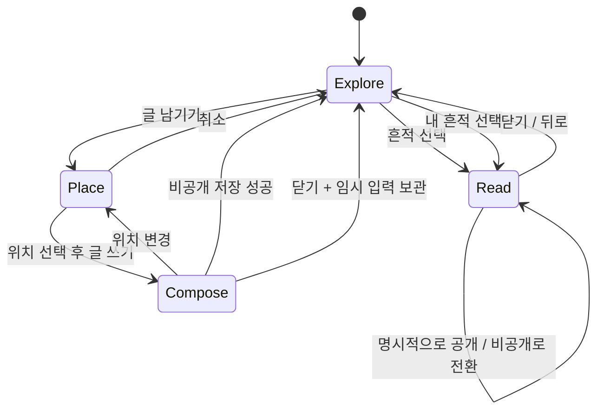

# 공통 장소 화면의 메시지 — 구현 설계 초안

**2026-11-07 적용 순서:** 아래는 초기 설계·참고 코드의 이력이다. 최신 개발은 [Sprint 1 App 상세 설계 v1](APP_SPRINT1_SPEC.md)을 따른다. 비공개 선행·contain 전용·추천 포함·기술값 미정 표현은 최신 결정으로 대체됐다. 공개 범위는 기본값 없이 선택, cover/contain 동일 변환, 16KiB 기술 상한, 추천은 보류다. 기존 참고 코드는 변경 전 조건의 증거이며 제품 코드와 구분한다.

작성: 2026-11-04. 사용자 요청: 다크소울의 메시지처럼 장소 안의 흔적을 발견해 열어보는 경험을 코드·UI 치수까지 설계한다.

**상태:** 사용자 방향을 구체화한 구현 제안. 참고 코드의 좌표·충돌·입력 검사만 실행했다. Android 화면·서버·접근성·사용자 가치 검증은 미실행이다. [화면 치수 도면](place-messages/layout.html), [타입과 외부 계약](place-messages/contract.ts), [좌표·겹침 코드](place-messages/geometry.ts).

**2026-11-04 후속 변경:** 사용자가 첨부한 게임 메시지 화면을 바탕으로, 크게 보이는 장소 사진 위에 연한 회색/흰색 반투명 리퀴드 글래스 쪽지를 띄우는 방향을 명시했다. 이전의 불투명 읽기 패널은 대체한다. 추천수 표시는 사용자 제안 기능이며 버튼·집계·정렬 계약은 아직 없다. 아래 기존 HTML은 변경 전 치수 도면으로, 큰 배경 사진·투명 쪽지·추천을 구현한 시안이 아니다. [최신 결정·제안 구분](../DESIGN.md#사진-위-리퀴드-글래스-쪽지와-추천)을 따른다.

## 1. 합의와 이번 제안

| 구분 | 내용 |
| --- | --- |
| 사용자 합의 | 리뷰 목록을 기본 화면으로 만들지 않는다. 공통 장소 화면에서 남겨진 흔적을 발견해 읽는다. 기록은 제목·질문 없이 자유 텍스트다. 공개 글은 내 기록 없이 읽는다. 비공개와 공개를 구분한다. 개인 사진을 기록용으로 보관하지 않으며 선택적 사진 보관은 기기 갤러리로 한다. |
| 이번 구현 제안 | 등록된 공통 사진 한 장에 정규화한 위치를 연결한다. 탐색 → 위치 선택 → 작성 → 비공개 저장 → 선택적 공개. 작은 표식의 시각 크기와 터치 크기를 분리한다. |
| 아직 검토할 값 | 표식 모양·색·밀도, 사진 구도, 읽기 패널 치수, 16KiB 입력 보호 상한, 노출 순서, 아래 수치 전체는 시작값이다. |

문제: 리스트·카드 넘기기는 장소를 둘러보며 발견하는 사용자의 의도를 담지 못한다. 가설: 공간에 놓인 글을 직접 여는 흐름이 장소를 다시 바라볼 계기를 준다. 게임의 참조만으로 관광 현장에서 효과가 검증된 것은 아니다. §10에서 발견·읽기 부담·다시 바라보기를 확인한다.

기준 범위는 하나의 공통 사진이다. 사진상의 위치는 글을 남긴 자리이며, 실제 기둥·현판의 의미를 검증한 주석이 아니다. 실시간 카메라 좌표, GPS의 정밀 위치, AR 공간 고정, 3D 장면은 이 계약에 포함하지 않는다. 부위 인식 작업은 별도 대상/영역 계약을 따른다.

## 2. 사용자 동작과 상태



- **Explore:** 사진과 흔적이 중심이다. 대표 사진 위에 본문·작성자·별점 목록을 깔지 않는다. `글 남기기`는 표시된 48dp 이상 버튼으로 제공한다. 길게 누르기는 필수 진입 동작이 아니다.
- **Place:** 일반 탐색에서는 빈 사진 터치가 글을 만들지 않는다. 작성 모드에서 사진 안을 누르면 해당 지점에 임시 표식 하나가 생긴다. 다시 누르면 위치를 바꾼다. 위치 선택 전 `글 쓰기`는 비활성이다. 선택하면 버튼과 표식이 즉시 변하므로 조작법 문단을 붙이지 않는다.
- **Compose:** 다중 행 텍스트 입력 하나와 `저장`, `닫기`, `위치 변경`만 둔다. 제목·태그·평점·질문은 없다. 공개를 저장 버튼에 결합하지 않는다. 초안은 sceneId와 anchor를 포함해 로컬에 보관한다.
- **Read:** 큰 장소 사진 위에 선택한 흔적 하나의 글을 읽는 반투명 리퀴드 글래스 쪽지를 연다. 바탕은 연한 회색 또는 흰색이며 사진이 자연스럽게 비친다. 선택 표식은 모양과 외곽선으로 구분한다. 닫으면 원래 사진·페이지·선택 위치로 복귀한다. 쪽지를 열 때 사진 구도를 갑자기 바꾸지 않는 방향을 제안하며 팝업 위치는 후속 시안에서 확인한다.
- 내 기록을 읽는 화면에서만 `공개하기`, 편집, 삭제를 제공한다. 공개한 글을 로컬에서 편집하면 원격에 자동 반영하지 않고 `공개 글에 반영`을 명시적으로 선택한다.
- 다른 사람의 글에는 신고 동작을 제공한다. 삭제·숨김된 글은 `지금은 볼 수 없는 글이에요`와 닫기를 표시한다. 빈 글 목록에는 가짜 글이나 가짜 표식을 만들지 않는다.
- 저장 실패 시 입력과 위치를 유지한다. 닫기 시 임시 저장 실패가 확인되면 화면을 유지하고 재시도/명시적 폐기를 제공한다. 자동 저장은 500ms 입력 정지 후와 화면 이탈 시 수행하는 제안이며, 프로세스 강제 종료 직전의 미기록 입력까지 보장하지 않는다.
- 공개 네트워크 요청의 타임아웃은 공개 실패로 단정하지 않는다. `확인 중` 상태로 두고 같은 ID의 서버 상태를 조회한다. 비공개 삭제와 공개 철회는 별개이며 원격 삭제가 불확실하면 로컬 대응 정보를 지우지 않는다.

## 3. 화면 치수와 레이어

React Native 숫자 크기는 density-independent 단위다. Android는 **dp**, 글자는 기본 크기에 사용자 글자 배율을 적용한다. 아래 HTML의 CSS px는 논리 치수 검토용이다. 실제 픽셀 수는 기기의 밀도에 따라 달라진다. [RN 크기 문서](https://reactnative.dev/docs/height-and-width).

**기준 도면:** 390 × 844 논리 크기, 예시 상단 safe area 24 / 하단 24. 실제 앱에서는 insets를 측정한다. 하단 공통 내비게이션의 탭 구성은 기존 화면 설계에 맡기며 여기서 탭을 새로 추가하지 않는다.

| 항목 | 시작값 | 반응형·예외 |
| --- | --- | --- |
| 상단 앱바 | 최소 56dp, 가로 여백 8dp | 제목 18/26, 조작 48×48. 큰 글자에서 높이 증가 |
| 공통 하단바 | 최소 64dp + bottom inset | 불투명 흰 바탕. 큰 글자에서 늘리고 본문 영역 재측정 |
| 장면 영역 | 앱바와 하단 도구 사이 나머지 전체 | 기준 도면 390×612. 화면/글자/회전 변경마다 재측정 |
| 장면 안쪽 보호 여백 | 사방 24dp | 사진 모서리의 흔적도 48dp 터치 영역이 부모 밖으로 나가지 않음 |
| 사진 | 보호 여백 안에서 contain, 비율 유지 | 전체 사진을 보여준다. cover 크롭·늘이기 금지. 실패 시 표식도 표시하지 않음 |
| 표식 그림 | 28×12dp, 외곽 대비선 2dp | 자체 벡터 형태. 이모티콘·게임의 룬/텍스처 복사 없음 |
| 표식 터치 | 48×48dp | 겹치지 않는 영역 사이 8dp. 그림이 작아도 hit box 축소 금지 |
| 선택 표시 | 36×20dp 외곽, 2dp 선 | 색만으로 상태를 구분하지 않음 |
| 장면 하단 도구 | 최소 64dp, 좌우 20dp, 내부 간격 8dp | `글 남기기` 최소 높이 48, 두 줄이면 높이 증가 |
| 읽기 패널 | 좌우 20dp, 최대 폭 560dp, padding 20dp, radius 16dp | 초기 높이 내용에 따라, 화면 가용 높이의 60% 상한. 긴 글은 내부 스크롤 |
| 패널 본문 | 16 / lineHeight 25 | 글자 확대를 제한하지 않는다. 200%에서 패널 확장과 스크롤 허용 |
| 작성 입력 | 16 / 25, 최소 160dp 높이 | 키보드가 열리면 작성 패널을 가용 영역으로 확장, 저장 행을 키보드 위에 유지 |
| 닫기·공개·저장 | 최소 48dp 높이 | 글자 배율에 따라 wrap/증가. 키보드·safe area에 가리지 않음 |
| 애니메이션 | 열기/닫기 160ms, opacity·8dp 이동 | motion 감소 시 즉시. 상시 점멸·파티클·자동 순환 없음 |

48dp 터치 기준은 [Android 접근성 문서](https://developer.android.com/guide/topics/ui/accessibility/apps)에 근거한다. RN `hitSlop`은 부모 영역을 넘지 못하며 겹친 sibling의 우선순위 문제가 있으므로 **48dp 실제 Pressable**을 배치한다. [Pressable 문서](https://reactnative.dev/docs/pressable).

레이어 순서: 사진 0 → 흔적 버튼 10 → 작성 위치 표시 20 → 장면 도구 30 → 모달 배경/읽기·작성 패널 40. 읽기 중 배경은 접근성·터치에서 비활성이고 패널을 닫으면 선택 표식으로 focus를 복원한다. 패널 때문에 사진 rect를 재계산하지 않는다. 키보드 표시 전 장면 rect를 스냅샷하고 작성 중 배경은 고정한다. 회전 시에만 정규화 좌표로 다시 계산한다.

2026-11-04 Android 표식 수정: 첫 갈색 표식 대신 28×28dp의 먹청색 반투명 원과 흰 말풍선 선을 사용한다. 선택 시 32×32dp의 진한 원과 2dp 흰 테두리를 표시한다. 위치와 48×48dp 터치 영역은 유지한다. 위 표의 28×12dp 주홍 표식은 초기안이다. **Liquid Glass의 주요 적용 대상은 메시지 쪽지 자체**다. 연한 회색/흰색 tint를 섞어 사진이 비치게 한다. 쪽지 내부의 약한 blur, 얇은 가장자리 빛·그림자, 배경 복잡도에 따른 불투명도 조절은 구현 후보이며 수치는 미정이다. 쪽지 바깥 사진은 유지하고 하단바는 불투명 흰 바탕을 쓴다. Android 표현·성능·가독성은 실제 앱에서 확인하며 효과 미지원 또는 접근성 요구 시 불투명 대체를 제공한다.

**현재 사진의 한계:** 저장소의 근정전 사진은 2000×1151이다. 기준 장면에서 342×196.82dp로 표시되므로 세로 여백이 크다. 현재 도면은 후속 요구인 큰 배경 사진을 충족하지 않는다. 공통 사진 구도 선정 또는 좌표 정합을 유지하는 확대/이동 방식으로 해결해야 하며 방식은 아직 미정이다. 기존 사진에 cover 속성만 적용하지 않는다. 확대/이동을 채택하면 사진·표식·터치에 동일한 변환을 적용하고, 아래 contain 전용 참조 코드의 검증 범위를 확장해야 한다.

## 4. 공통 사진과 위치 계약

첫 버전은 개인 촬영 사진으로 장소를 찾고, 쪽지 작성·열람은 공통 사진에서 수행한다. 사용자 대화와 임의 사진 간 정합을 보류한 기술적 이유는 [ADR 0001](../adr/0001-shared-place-photo-anchors.md)을 따른다.

기존 `Target.id`를 `placeId`로 참조한다. 새 장소 목록을 복제하지 않는다. `sceneId`는 **변하지 않는 한 사진 구도**를 가리킨다. 예: `geunjeongjeon-front-v1`. 같은 장소의 다른 시점은 다른 sceneId다.

```ts
type Anchor = { u: number; v: number }; // 각각 0..1, 원본 사진 기준
// 저장 예시: { sceneId: 'geunjeongjeon-front-v1', anchor: { u: 0.62, v: 0.73 }, body: '...' }
// 기기의 화면 x/y, 사진 파일, 실제 세계 좌표를 기록에 넣지 않는다.
```

이미지 크기 Iw/Ih, 장면 Sw/Sh, 보호 여백 p=24일 때:

```text
s = min((Sw - 2p)/Iw, (Sh - 2p)/Ih)
rw = Iw*s; rh = Ih*s
rx = (Sw-rw)/2; ry = (Sh-rh)/2
화면 위치 x = rx + u*rw; y = ry + v*rh
저장 위치 u = (x-rx)/rw; v = (y-ry)/rh
```

예: 390×612 장면, 2000×1151 사진 → rect (24, 207.59, 342, 196.82). (u=.62, v=.73) → (236.04, 351.2686). 사진/표식은 반드시 같은 rect를 쓴다. 터치 입력은 장면 기준 x/y로 바꾸고 letterbox 밖 입력은 버린다. 자식 버튼 기준 `locationX`를 장면 좌표로 오인하지 않는다.

기준 사진 파일의 구도를 자르거나 방향을 바꾸거나 다른 사진으로 교체하면 **새 sceneId**를 만든다. 같은 원본의 화면 크롭은 표시 변환이므로 ID를 바꾸지 않고 사진과 쪽지에 같은 변환을 적용한다. 동일 구도의 해상도 파생본은 같은 좌표를 쓸 수 있으며 메타데이터에서 원본과 비율을 검증한다. 이전 글을 새 사진에 자동 재배치하지 않는다. 이전 scene은 읽기용으로 유지하거나 명시적 이용불가 상태를 제공한다.

## 5. 글이 많은 경우와 접근성

- 첫 조회는 sceneId별 marker 60개 이내, createdAt DESC / id DESC와 snapshot cutoff를 포함한 커서 페이지를 초기 기술안으로 둔다. API 커서는 opaque 값으로 취급한다. 후속 대화에서 추천수 표시와 추천이 많은 흔적·새 흔적의 혼합 노출이 제안됐으므로 최종 순서는 미정이다. 혼합을 채택하면 커서와 정렬 계약도 함께 갱신한다.
- 글 본문은 흔적을 열 때 조회한다. 메인에서 글을 선택해 들어오면 해당 ID의 scene과 anchor를 먼저 가져와 첫 페이지 밖이어도 그 글을 열 수 있다. 본문이 없어진 경우 그 장소로는 계속 들어갈 수 있다.
- 겹침은 **저장 좌표가 아닌 표시 좌표**에서 계산한다. 48dp 터치 영역과 8dp 간격이 겹치면 그룹으로 합치고 다시 검사한다. 참조 코드는 최대 60개 입력에서 순서를 고정해 같은 결과를 만든다.
- 그룹은 겹친 선 모양과 개수를 표시한다. 눌렀을 때 해당 묶음의 글 하나를 열고 `이전 글`/`다음 글` 버튼으로 묶음 안에서 이동한다. 주 화면은 여전히 장소와 흔적이다. 읽는 글의 원래 anchor는 별도 선택 표시로 보여준다. 그룹 중심은 건물 부위 주석이 아니다.
- 다음 페이지는 사용자가 `다른 흔적`을 눌렀을 때 교체한다. 읽기 중 실시간 재배치하지 않는다. 돌아오기에서는 페이지 커서·표식 집합을 복원한다. 첫 조회에 늦게 도착한 응답도 현재 scene/request와 다르면 무시한다.
- 동일 지점 글이 많거나 연쇄 충돌하면 큰 그룹 하나로 합쳐질 수 있다. 이 알고리즘은 터치 겹침 해소의 출발점이며 발견 경험의 품질이 검증된 것은 아니다. 60개 밀집 사례의 실제 표시를 보고 확대·페이지 크기를 조정한다.
- TalkBack에는 `사진 왼쪽 위의 글`, `사진 가운데의 글 3개`처럼 위치와 동작을 제공한다. 탐색 focus는 위→아래, 왼쪽→오른쪽으로 고정한다. glyph 자체는 별도 focus를 받지 않는다.
- 위치 선택은 touch뿐 아니라 접근성 사용자에게 중앙에서 시작하는 위치 선택점과 48dp 방향 버튼/좌표 이동 action을 제공한다. 5% 단위 이동 후 확정할 수 있다. 스와이프만으로 위치를 고르게 하지 않는다.
- 선택/읽음/내 글은 색 외에 외곽선·점·접근성 상태로 구분한다. 읽음 기록을 서버에 수집하는 기능은 이 설계에 포함하지 않는다.

## 6. 코드 구조

현재 앱에는 실행 확인용 route 3개만 있다. package.json에서 Expo 57.0.31, RN 0.86.3, Reanimated 4.5.1을 확인했다. 아래 파일은 **향후 생성할 구조**이며 현재 앱에 추가하지 않았다.

```text
mobile/src/app/places/[placeId]/scene.tsx       # route 입력 검증·공통 화면 연결
mobile/src/features/place-messages/
  SceneScreen.tsx                              # 모드별 화면과 focus
  SceneCanvas.tsx                              # image rect·marker pressables
  MessageReader.tsx                            # 선택 글 하나·신고·소유자 동작
  MessageComposer.tsx                          # 자유 텍스트·키보드·저장 결과
  useSceneMessages.ts                          # 취소·오래된 응답·화면 상태
  geometry.ts                                 # 순수 좌표·충돌 계산
  contract.ts                                 # 타입·입력 제약
  localNotes.ts                               # 로컬 draft/note 트랜잭션
  publicMessages.ts                           # 원격 조회·공개·철회·재시도 조정
```

화면은 SQL·API 응답을 직접 조합하지 않는다. geometry는 RN·네트워크를 import하지 않는다. 로컬 저장과 원격 저장은 수명·실패 조건이 다르므로 한 개의 `save()`로 숨기지 않는다. 공개 조정은 publicMessages 내부에서 처리한다. 참고 타입의 PublicMessages는 현재 실제 adapter가 없으므로 향후 외부 계약이며 불필요한 범용 Repository 계층을 더 쌓지 않는다.

RN 조립 형태(구조 예시, 컴파일·연결 전):

```tsx
<View onLayout={measureStage} style={{ flex: 1 }}>
  <Image source={sceneImage} style={imageRect} resizeMode="contain" />
  {groups.map(group => (
    <Pressable
      key={group.ids.join(':')}
      accessibilityRole="button"
      accessibilityLabel={labelForPosition(group)}
      onPress={() => openGroup(group.ids)}
      style={{ position: 'absolute', left: group.x - 24, top: group.y - 24,
        width: 48, height: 48, alignItems: 'center', justifyContent: 'center' }}
    >
      <TraceGlyph selected={isSelected(group)} count={group.ids.length} />
    </Pressable>
  ))}
</View>
```

`Image`의 style은 실제로 `{position:'absolute', left:rect.x, top:rect.y, width:rect.width, height:rect.height}`로 변환한다. 위 imageRect 변수는 이 렌더용 style을 뜻하며 geometry의 x/y 객체를 그대로 전달하지 않는다. 배경 사진 터치는 작성 모드에서만 활성화한다. 읽기/작성 패널은 접근성 focus를 제한하는 모달로 만든다. 단순 zIndex 배치만으로 접근성이 해결됐다고 판단하지 않는다.

## 7. 저장과 서버 규칙

현재 최신 Backlog는 Supabase 채택을 기록하지만 ARCHITECTURE의 일부 과거 절에는 미정 표현이 남아 있다. **공유 저장소는 Backlog의 Supabase를 기준으로 설계하고 연결 상태는 미검증**으로 둔다. 이번에 계정·프로젝트 생성·migration 실행·패키지 설치는 하지 않는다.

| 자료 | 보관 | 핵심 필드·규칙 |
| --- | --- | --- |
| 공통 사진/scene | 검수 asset + 배포 manifest / 서버 scene 목록 | id, placeId, assetId, 비율, hash. scene 불변, 공개 가능한 asset만 연결 |
| 초안·비공개 글 | 기기 로컬 DB 제안 | id, sceneId, u/v, body, updatedAt. 사용자 사진 사본 없음 |
| 공개 글 | Supabase public_messages | id(UUID), owner_id, scene_id FK, u/v, body, moderation_state, created_at, updated_at |
| 신고 | 별도 비공개 서버 저장 | reporter, message_id, reason, created_at. 일반 조회에서 반환하지 않음 |

저장 ID는 초안 생성 때 한 번 만들고 재시도에 재사용한다. publish는 비공개 글을 그대로 원격 동기화하는 기능이 아니라 사용자가 선택한 글의 공개 사본을 만드는 동작이다. 공개 요청에 photo URI·file·개인 draft 내용을 덧붙이지 않는다.

서버 필수 검사:

1. scene FK가 존재하고 게시 가능한 상태인지 확인. u/v는 finite이며 0..1. body는 공백만으로 구성되지 않고 UTF-8 16,384bytes 이내라는 기술 상한을 제안한다. 실제 값 채택은 후속 결정이다. 본문은 plain text로 렌더하고 HTML/Markdown을 실행하지 않는다.
2. 읽기는 `moderation_state = visible`인 공개 글만 허용한다. 사용자 기록 유무와 무관하다. 작성자 관리 조회는 본인만 허용한다. 숨김 글은 일반 읽기에서 즉시 제외한다.
3. 쓰기·수정·삭제는 인증된 작성자만. Supabase Auth의 `auth.uid()`를 소유권 기준으로 서버에서 검사한다. client가 owner_id를 다른 사람으로 바꾸거나 moderation_state를 visible로 복구할 수 없어야 한다. INSERT/UPDATE의 `WITH CHECK`, 수정 가능한 column 제한, SELECT/DELETE 규칙을 각각 검증한다. `UPDATE USING`만으로 끝내지 않는다.
4. 신고와 게시 빈도 제한은 서버에서 처리한다. 클라이언트의 버튼 비활성만으로 대체하지 않는다. 서버에서만 쓰는 권한 키를 앱에 넣지 않는다.
5. 동일 ID 재시도는 같은 소유자의 동일 공개 요청만 성공으로 조정한다. 이전과 body/anchor가 다르면 조용히 덮어쓰지 않고 명시적 편집 절차를 사용한다.
6. 로그인 없이 열람할 수 있게 설계한다. 게시 시에는 현재 T15 계획의 Supabase 익명 Auth로 작성자 식별자를 확보한다. 익명 세션을 잃거나 앱을 삭제하면 소유권을 복구할 수 있는지와 계정 연결 UX는 구현 전에 정리해야 한다. 익명 Auth는 무인증 쓰기 권한을 뜻하지 않는다. 읽기 시작에 로그인은 요구하지 않는다.

참고 [Supabase RLS](https://supabase.com/docs/guides/database/postgres/row-level-security). 위 내용은 정책 요구사항이며 실행 가능한 migration을 완료했다는 뜻은 아니다. 실제 구현은 사용자 A/B/비로그인 상태의 직접 API 요청으로 검사한다.

## 8. 기존 디자인 자산 재사용

원본 k-style pin `a5b1955bd628657b2fbb18c4b05c9aff58d2284d`의 생성 토큰과 components.css를 시작점으로 쓴다. 읽기용 HTML 도면에는 원본 components.css와 MIT 고지를 그대로 복사하고 `.appbar`, `.appbar-title`을 재사용한다. 원본 appbar 버튼 44dp는 이 설계에서 48dp로 확장한다. 원본을 수정하지 않고 확장 CSS로 적용한다.

| 원본 | 적용 |
| --- | --- |
| `--page-x:20`, `--stack-s:8`, `--stack-m:12`, `--stack-l:24` | 외곽·조작 간격 |
| `--r-l:16`, `--h-appbar:56`, `--h-tab:64` | 패널·상하단 골격 |
| `--c-surface:#FFF`, `--c-brand:#243247`, `--c-line:#E8E9EA` | 흰 화면·먹청색·경계 |
| 사용자 별도 요구 | 주홍 흔적, 표식 좌표, 밀집 묶음, 제한된 Liquid Glass, 글 읽기 모달은 자체 구현 |

원본 CSS를 React Native에 직접 import하지 않는다. 앱에서는 같은 이름의 TS 토큰으로 매핑하고 native style/동작을 구현한다. 도면 서체는 로컬 시스템 서체이며 원본 기본 Pretendard를 프로젝트 채택으로 간주하지 않는다. 원본 자동 배경색보다 사용자의 흰 배경 지침이 우선이다.

Skullet은 로딩 형상·동작 참고다. 사진에는 동일 비율의 뼈대를 두되 가짜 메시지 위치를 만들지 않는다. 사진이 로드되면 서버 응답 대기 중에도 장소를 볼 수 있고, 실패 시 재시도만 제공한다. RN 직접 사용과 native 구현 성능은 검증 전이다.

### 추천 기능의 후속 설계 항목

사용자는 추천수가 보이는 게임 메시지 화면을 참조로 제시했다. 쪽지 하단에 작은 추천 버튼과 숫자를 두는 방향을 검토한다. 현재 `contract.ts`에는 추천수·본인 추천 여부·추천 쓰기 계약이 없다. 다음 실제 공유 설계에서 추천/취소, 사용자별 중복 방지, 동시 집계, 실패 시 화면 복원, 숨김·삭제된 글의 처리와 인증 조건을 정해야 한다. 추천을 많이 받은 글과 새 글의 혼합 노출은 어시스턴트 제안으로, 최종 비율·정렬·노출 효과는 확정하거나 검증하지 않았다.

## 9. 구현 순서

2026-11-04 대화에서 제안한 순서다. 사용자 후속 요청으로 1단계의 근정전 읽기 시안에 착수했다. 구현과 검증 상태는 [Android 검증 기록](../../mobile/VERIFICATION.md)에서 구분한다.

1. **Android에서 한 장소의 발견·읽기 시연:** 큰 공통 사진, 흔적 선택, 반투명 리퀴드 글래스 쪽지, 추천 버튼의 전후 상태, 닫기와 원위치 복귀. 개발용 글·추천수를 사용하며 실제 사용자 글·서버 집계와 구분한다. K-style 원본 규칙·구성 요소를 재사용하고 글래스·공간 배치를 확장한다. 사진의 현장감·가독성·터치·큰 글자에서 검토한다.
2. **위치 선택과 로컬 기록:** 자유 텍스트 저장, 재실행 복원, 비공개 표식, 밀집 묶음, 긴 글·키보드·뒤로가기. 화면 시연의 fixture를 영구 사용자 기록으로 섞지 않는다.
3. **실제 공유:** 인증·RLS·명시적 공개·철회·신고·타임아웃 조정, 두 기기 확인. 로컬 fixture 확인을 공유 완료로 보고하지 않는다.
4. **메인 연결:** 공개 message ID → scene/anchor → 같은 글을 펼친 화면. 삭제·사진 버전 변경 상태 처리.

사진 갤러리 저장은 별도 선택 동작이다. 추후 구현 시 Expo 57 [MediaLibrary 문서](https://docs.expo.dev/versions/v57.0.0/sdk/media-library/)와 설치 버전을 확인한다. 현재 의존성에 해당 패키지는 없다. 공통 사진 저장은 asset의 재이용 조건을 따르고 개인 촬영 사진의 저장과 구분한다.

## 10. 검증 계획과 실행 증거

| 사례 | 기대 결과 | 현재 |
| --- | --- | --- |
| 320/360/390/600 폭, 가로·세로 원본 | 같은 u/v 투영·역변환 오차 1e-10 이내, 모서리 hit box 장면 안 | 참고 코드 통과 |
| letterbox·NaN·범위 밖 입력 | 기록 위치 생성 안 됨 / invalid 입력 거부 | 참고 코드 통과 |
| 60개 밀집·순서 역전 | ID 누락·중복 없이 묶음, 48dp 영역 겹침 없음, 결과 순서 일관 | 참고 코드 통과 |
| 한글 여러 줄·공백·상한 초과 | 원문 유지, 빈 글/상한 초과만 거부 | 참고 코드 통과 |
| RN 이미지와 실제 터치 | 사진/표식 오차 ≤1dp, 경계/회전/리사이즈 일치 | 미실행 |
| 200% 글자·TalkBack·키보드·뒤로 | 저장/닫기 접근 가능, focus 복원, 작성 내용 보존 | 미실행 |
| 다른 scene의 늦은 응답 | 현재 scene을 덮지 않음 | 미실행 |
| 저장 실패·앱 재시작·공개 타임아웃 | 입력 보존, 중복 게시 없음, 공개 상태 정직하게 표시 | 미실행 |
| A/B/비로그인 직접 요청 | 공개만 열람, 타인 수정/삭제 거부, 숨김·삭제 반영 | 미실행 |
| 메인 링크 → 첫 페이지 밖 글 | 올바른 scene/글/anchor 열림, 삭제면 이용불가와 장소 유지 | 미실행 |

참고 코드 재검사(저장소 루트, 기존 TypeScript 사용):

```powershell
node mobile/node_modules/typescript/bin/tsc docs/design/place-messages/contract.ts docs/design/place-messages/geometry.ts --strict --target ES2022 --module commonjs --lib ES2022,DOM --skipLibCheck --outDir .codex-build/place-message-reference
node docs/design/place-messages/verify.cjs .codex-build/place-message-reference
```

2026-11-04: strict compile 성공, 위 4개 reference checks 통과. 총 968개 투영/역변환 조합을 포함한다. 제품 앱에 import하지 않았으며 패키지 설치·서버 연결·에뮬레이터 실행은 하지 않았다. HTML은 구조·로컬 참조·script 구문 검사를 수행한다. 브라우저가 file 프로토콜을 차단해 실제 렌더링·상태 버튼 동작은 미검증이다. 도면은 위치 선택·저장 동작까지 구현한 제품 프로토타입이 아니다.

사용자 관찰: 동일 장소·동일 글을 사용해 기존 목록과 이번 공간 배치를 비교하되 최종 화면에 목록을 기본 채택하지 않는다. 발견한 흔적, 자발적 다음 열람, 글을 읽은 뒤 사진/현장을 다시 본 행동, 겹침으로 놓친 글, 읽기 부담을 기록한다. 도움말 없이 흔적 열기·닫기·위치 선택·비공개 저장을 해보게 한다. UI 동작 통과와 사용자 가치 입증은 구분한다. 성능은 marker 수별 화면 반응을 실제 Android에서 측정한 후 판정한다.
