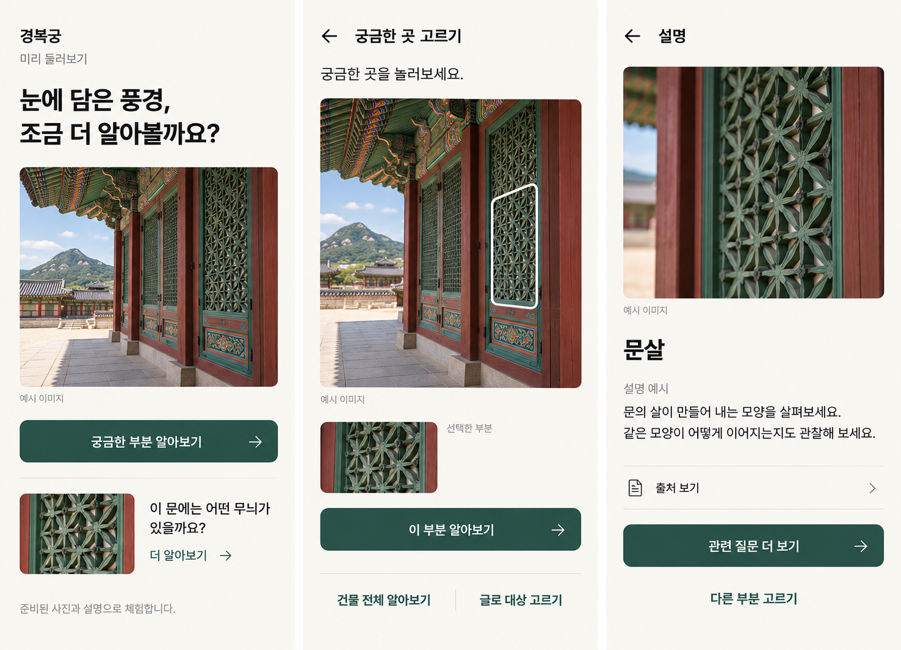
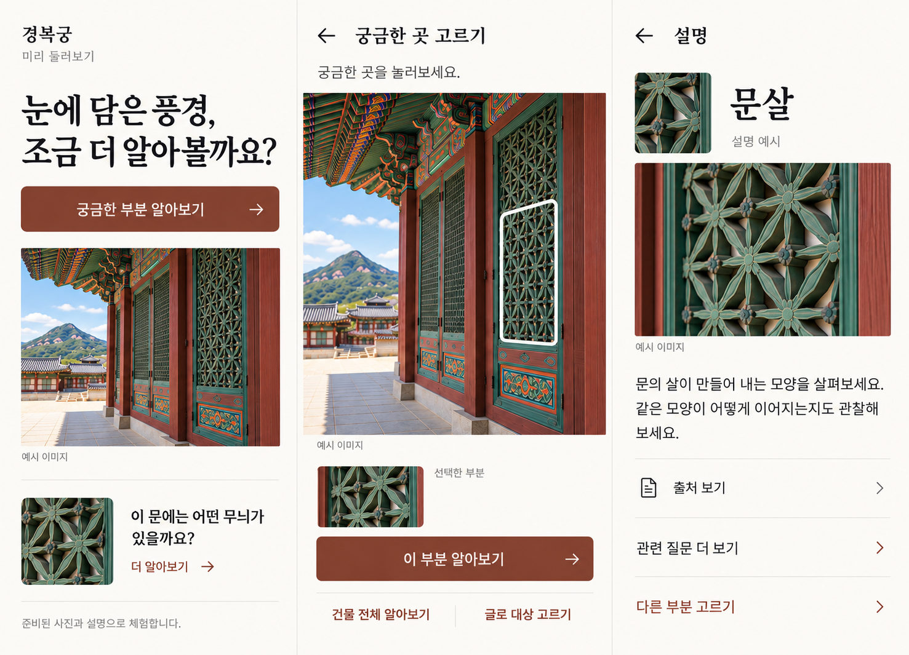

# AI slop 방지와 Worst 예시

작성·검토일: 2026-10-14. 용도: 이 프로토타입에서 반복하지 않을 디자인을 증거와 함께 관리한다. 합의 기준은 [DESIGN](../DESIGN.md), 긍정 참고는 [VISUAL_REFERENCES](VISUAL_REFERENCES.md)다.

여기서 ‘AI slop’은 출처·사용 과업과 관계없이 관성적으로 붙는 표현을 가리킨다. 시각만 보고 다른 제품이 AI로 제작됐다고 판정하지 않는다. ‘Worst’는 우리 설계 목표에 맞지 않는 사례이며 보편적인 미적 순위가 아니다.

## 1. 조사에서 확인한 내용

- [Anthropic 공식 frontend-design 지침](https://github.com/anthropics/skills/blob/main/skills/frontend-design/SKILL.md)은 크림 바탕·세리프 제목·테라코타 강조, 검정 바탕·강한 단일 강조, 신문형 레이아웃, 같은 둥근 카드의 반복 등을 관성적인 기본형으로 지적한다. 불필요한 번호·영문 라벨·일괄적인 등장 효과도 점검 대상으로 다룬다. [조사한 원문](https://raw.githubusercontent.com/anthropics/skills/main/skills/frontend-design/SKILL.md).
- 같은 지침은 이런 표현이 특정 요청에서는 적절할 수 있고 사용자의 구체적인 방향이 우선이라고 설명한다. 따라서 둥근 모서리·흰 화면·기본 글꼴을 일괄 금지하지 않는다.
- 이는 도구 제작자의 실무 지침이다. AI 디자인 전체의 발생 빈도나 원인을 입증한 연구 결과로 인용하지 않는다. ‘학습 데이터 때문에 반드시 이렇게 된다’는 원인 주장은 이번 조사로 확인하지 않았다.
- [Apple 공식 디자인 소개](https://www.apple.com/newsroom/2025/06/apple-introduces-a-delightful-and-elegant-new-software-design/)의 콘텐츠 우선·조작부 그룹화와 실제 사진 앱 화면을 긍정 기준으로 사용한다. 특이함보다 과업에 맞는 위계를 우선한다.

## 2. 실제 제외 예시

### W01 — 미색 안내서형



- 출처·작성: 이 프로젝트의 2026-10-14 이미지 생성 시안. 실제 앱 화면이 아니다. 원본 이미지를 수정 없이 보관했다.
- 상태: **제외**. 사용자 요청으로 누런 배경을 금지한 이후의 구현 기준으로 쓰지 않는다.
- 관찰: 미색이 화면 전반을 덮고, 설명 화면의 관련 질문이 진한 채움 버튼으로 강조된다.
- 문제: 합의한 흰 배경과 충돌한다. 답을 읽는 화면에서 추가 질문의 시각적 비중이 과하다. 후자는 설계 검토 의견이며 사람 테스트로 확인한 실패는 아니다.
- 대체: 흰 배경·청록 주 행동을 사용하고, 관련 질문은 보조 행/링크로 낮춘다.
- 재검토: H/V/A의 넓은 바탕을 확인하고, A에서 이름·답과 다음 행동의 우선순위를 비교한다.

### W02 — 크림·세리프·갈색 강조 편집형



- 출처·작성: 이 프로젝트의 2026-10-14 이미지 생성 시안. 실제 앱 화면이 아니다. 원본 이미지를 수정 없이 보관했다.
- 상태: **제외**. 화면 전체 스타일을 재사용하지 않는다.
- 관찰: 크림 바탕, 큰 세리프 제목, 갈색 계열 버튼이 지배적이다.
- 문제: 전통 상품의 구체적인 특징보다 일반적인 편집 디자인 조합에 의존했다. 새로 합의한 실제 앱 중심·둥근 UI·단청 청록 방향과 맞지 않는다.
- 대체: 실제 앱의 제목·정보 위계와 G01/G02의 제한된 단청 포인트를 참고한다. 관련 질문을 작은 보조 행으로 표현한 부분은 별개로 검토할 수 있다.
- 재검토: 설명 없이도 구현자가 어느 실제 UI와 상품의 어떤 요소를 사용했는지 추적할 수 있는지 확인한다.

위 이미지의 생성 건물·문양·설명은 역사·학습 콘텐츠의 근거가 아니며 앱 자산으로 가져오지 않는다. 제외 예시는 수정본으로 덮어쓰지 않고 후속 이미지·판정 링크를 추가한다.

## 3. 방지 규칙과 반례 관리

| ID | 걸러낼 패턴 | 우리 과업에서의 문제 | 대체 / 검토 방법 | 근거 수준 |
| --- | --- | --- | --- | --- |
| A01 | 누런·크림·베이지 배경 | 명시적 시각 요구와 충돌 | 넓은 배경·정보 면을 흰색/중립 회색으로 확인. 사진의 고유색은 별도 | 사용자 합의, W01/W02 |
| A02 | 모든 내용을 같은 둥근 카드·그림자로 감싸기 | 사진·설명·보조 행동의 위계가 평평해짐 | 기능 단위만 묶고 일반 문장은 평면에 배치. 반경은 크기·역할별로 일관되게 사용 | 외부 지침 + 프로젝트 적용 |
| A03 | 사진과 떨어진 큰 홍보 문구·아래로 밀린 주요 행동 | 앱보다 웹 안내 페이지처럼 느껴지고 과업 시작이 어려워짐 | 사용자 요청의 큰 사진/3D는 허용. 주 행동을 같은 장면 안에 두고 작은 화면에서 확인 | 2026-10-15 사용자 수정 요청 + 프로젝트 설계 검토 |
| A04 | 보라 그라데이션·광택·블러를 기본 장식으로 사용 | 선택한 전통 색·사진을 흐리고 조작부 대비가 달라짐 | 효과마다 목적을 설명하고 효과 없는 화면과 비교 | [Anthropic 플러그인 소개](https://claude.com/plugins/frontend-design) + 프로젝트 적용 |
| A05 | 단청 오색·국새·용·궁궐 문양을 동시에 크게 사용 | 안내 대상보다 장식이 먼저 보임 | 주 모티프 하나, 청록 주색·붉은 소량 포인트. 사진·답을 가리지 않는지 확인 | 프로젝트 설계 판단 |
| A06 | 전통=한지·붓글씨·낡은 색으로 자동 처리 | 실제 굿즈의 현대적 재해석을 놓침 | G01~G03처럼 원본의 특정 형태·색을 고르고 사용 위치를 기록 | 상품 관찰 + 사용자 합의 |
| A07 | 불필요한 영문 라벨·장식 번호·화살표 반복 | 한국어 안내의 정보량만 늘림 | 순서가 실제 있는 경우만 번호 사용. 아이콘은 행동 의미가 있을 때 사용 | 외부 지침 + 프로젝트 적용 |
| A08 | 가짜 스캔·로딩·정확도·AI 반짝임 | 준비된 답을 실제 인식 결과처럼 보이게 함 | SCREENS의 정직한 준비 자료 안내와 실제 상태만 표시 | 기존 제품 범위 |
| A09 | 장식을 위해 작은 글자·낮은 대비 사용 | 현장에서 설명을 읽기 어려울 위험 | 본문 16px 이상부터 검토, 대비·200% 확대·실기기 확인 | 기존 접근성 기준 |

반례: 둥근 버튼·시스템 한국어 글꼴·큰 사진과 필요 있는 모션은 허용한다. 사용자가 단색 초록 버튼을 제외했으므로 현재 주 행동은 단청 조합을 곁들인 밝은 유리 면으로 바꿨다. ‘AI 같아 보임’만으로 사용자 선호를 뒤집거나 비대칭·세리프를 강제로 추가하지 않는다. Liquid Glass·탄성은 사용자가 요청한 요소이며 버튼·내비게이션과 사진 연결에 목적을 두고 사용한다.

## 4. Sol과 리뷰에서 사용하는 방법

2026-10-15 사용자 피드백으로 추가한 실제 구현의 문제:

| ID | 관찰 | 변경 | 남은 판단 |
| --- | --- | --- | --- |
| A10 | 3D 뒤 넓은 옅은 민트 면과 그림자가 AI 시안처럼 느껴짐 | 흰 화면과 같은 배경, 카드 그림자 제거 | 시각 선호는 사용자 재확인 |
| A11 | 위아래 같은 사진이 반복되고 둥근 사진 박스로 끊김 | 대표 근정전과 탐색 굴뚝으로 분리, 화면 폭 사진과 흰 글 면으로 연결 | 대표 사진과 탐색 대상의 구분이 이해되는지 관찰 |
| A12 | 유리 효과를 blur·파스텔·중첩된 원형 장식으로만 표현 | 조작부의 재질을 분리하고 입력·취소·초점 상태를 정의 | 네이티브와 같다는 표현 금지, 실기기 반응 확인 |

공식 근거와 재사용 기준은 [재질·입력 반응 분류](../design/INTERACTION_MATERIALS.md)를 따른다. 위 항목은 우리 구현에 대한 사용자 피드백이며 모든 AI 디자인에 대한 일반 통계가 아니다.

1. UI 작업 전에 DESIGN, VISUAL_REFERENCES, 이 문서를 읽는다. 사용자 합의를 스킬의 기본 스타일보다 우선한다.
2. 화면별로 `참고 ID → 가져온 특징 → 적용 위치`를 적는다. 생성 이미지 자체를 실제 앱의 근거로 부르지 않는다.
3. 디자인 토큰을 구현한 뒤 기준 화면 H/V/A를 같은 크기로 캡처한다. 기본·선택·미지원 상태를 비교한다.
4. A01~A09를 `통과 / 수정 필요 / 해당 없음 / 미확인`으로 기록한다. 색 대비·조작 확인이 없으면 검증 완료라고 쓰지 않는다.
5. 새로운 실패 사례는 이 문서에 등록하고 해당 Issue/PR의 수정 증거를 연결한다. 매번 전체 제품을 재설계하지 않는다.

추가 기록 형식:

```text
ID / 관찰일 / 상태:
원본 URL 또는 저장소 이미지 / 제작 출처:
관찰한 화면과 문제:
위반한 사용자 기준 또는 과업 영향:
대체 방법:
검토 방식과 실제 결과:
후속 Issue/PR:
```

W01/W02는 이미지가 있는 실제 제외 사례다. A02~A09 중 해당 이미지로 입증되지 않은 항목은 예방 기준이며, 외부 서비스의 실패 사례를 수집·검증했다고 주장하지 않는다. 현재는 정적 설계 검토까지 수행했고 앱·사람 테스트는 미실행이다.
