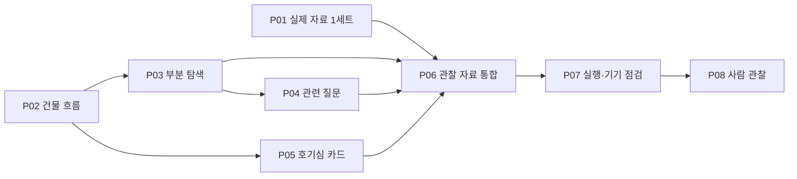

# 프로토타입 작업 분할안과 Issue 초안

상태: 발행 전 작업안. P01~P08은 설계 내 식별자이며 GitHub Issue 번호가 아니다. 진행 상태는 Issue 발행 후 그곳에서만 관리한다. 이 문서에는 작업의 경계와 발행할 수용 조건을 둔다.

## 1. 상위 Issue 초안

**제목:** `[Prototype] 경복궁 전체·부분 탐색과 호기심 카드의 시나리오 검증`

**문제:** 경복궁 방문객이 건물 이름이나 문양·구조물의 의미를 궁금해할 때, 이름을 알아내고 맞는 설명을 찾는 노력이 필요할 수 있다. 준비된 소수 장면에서 대상 지정과 설명 접근을 쉽게 만드는 흐름을 관찰한다.

**사용자 결과:** 사용자가 건물 전체 또는 사진의 관심 부분을 고르고 이름·짧은 설명·출처를 확인한다. 더 궁금하면 준비된 관련 질문을 선택한다. 홈의 카드가 관심을 끌면 같은 설명 화면으로 들어가고, 관심이 없으면 무시할 수 있다.

**범위:** 모바일 웹의 실제 상호작용, 사전 연결 사진·대상·설명, 모의 관람 3상황, 선택 수정·미지원·자료 오류 복구. 자유 질문 입력·LLM·자동 인식·실제 위치·지도·설치·음성·다국어는 제외한다.

**상세 설계:** [설계 시작점](README.md), [화면](SCREENS.md), [자료](DATA.md), [관찰 계획](TESTING.md). 발행 시 설계가 포함된 실제 커밋/PR의 GitHub 링크로 바꾼다. 아직 main에 없는 파일을 main URL로 연결하지 않는다.

**상위 수용 조건:**

- S1 건물 전체, S2 문양·구조물 탐색, S3 선택적 카드 경로를 시연할 수 있다.
- 관심 부분을 고친 뒤 대상·설명·출처가 함께 바뀌며 미지원 부분을 임의 대상으로 바꾸지 않는다.
- 관찰에 쓰는 사진·설명은 출처·이용 조건·대상 일치 검수가 끝난다.
- 기능 확인 F01~F13의 수행/실패/미실행과 환경이 기록된다.
- 첫 모의 관찰은 준비 여부와 분리해 실제 시행·개입·결과를 기록한다. 관찰 전에는 상위 Issue 전체 완료로 표시하지 않는다.
- 자동 인식·응답 속도·현장 효과·일반 사용자 성공률을 검증했다고 주장하지 않는다.

**진행 구분:** P01~P07은 구현·관찰 준비. P08은 사람과 수행하는 관찰. Sol의 코드 작업 종료는 P07까지이며 P08 자동 완료를 요구하지 않는다.

## 2. 의존 관계와 권장 순서

| 작업 | 결과 | 선행 조건 | 담당 제안 |
| --- | --- | --- | --- |
| P01 | 실제 건물 장면 하나의 검수된 콘텐츠 | 없음 | Sol 자료 조사·정리, 사용자 최종 검토 |
| P02 | 홈→건물 전체→설명이 실행되는 첫 버전 | 없음. 개발 fixture로 시작 가능 | Sol |
| P03 | 문양·구조물 선택·수정·해당 없음 | P02 | Sol |
| P04 | 기본 설명 뒤 관련 질문·답변 없음 | P03 | Sol |
| P05 | 방문 맥락과 선택적 호기심 카드 | P02 | Sol |
| P06 | 실제 자료로 S1~S3이 연결된 관찰용 버전 | P01, P03, P04, P05 | Sol, 사용자 콘텐츠 확인 |
| P07 | 복구·접근성·기기 확인과 실행 패키지 | P06 | Sol 자동/브라우저 검사, 사용자 실기기 |
| P08 | 모의 관찰·해석·후속 Issue | P07의 관찰 시작 조건 충족 | 사용자 진행, 협조자 참여, Sol 정리 지원 |

권장 단일 실행 순서는 P01→P02→P03→P04→P05→P06→P07이다. P01 자료 확보가 지연되면 P02부터 개발 fixture로 진행한다. 이 그래프는 의존 관계이며 여러 에이전트의 동시 실행 지시가 아니다. 매 작업의 검사·시연이 끝난 후 다음으로 이동한다.

## 3. 모든 구현 작업의 공통 계약

- 시작: 실제 Git 상태, 기준 Issue/설계 버전, 선행 작업 산출물 확인. 다른 작업자의 변경을 보존한다.
- 구현: 맡은 사용자 흐름의 자료→상태→UI를 함께 잇는다. 관련 실패·수정 경로도 같은 작업에 포함한다.
- 검증: 아래 인수 조건을 관찰 가능한 행동으로 확인한다. 필요한 자료·상태 경계에만 자동 검사를 둔다.
- 기록: 실제 파일·명령·결과·남은 제한을 PR/완료 보고에 남긴다. 문서의 계획 명령을 실행 성공으로 복사하지 않는다.
- 종료: 새로운 문제가 있으면 고치거나 구체적인 장애와 다음 작업을 연결한다. UI가 보인다는 이유만으로 정상·복구 흐름 전체 통과로 표시하지 않는다.

각 Issue 본문은 상위 Issue 전체 URL, 아래 작업의 목표/범위/인수 조건/선행 Issue URL/관련 설계 링크를 담는다. 라벨은 실제 저장소 목록을 확인하고 존재하는 것만 사용한다.

## P01 — 실제 건물 장면 하나의 콘텐츠 확보

**목표:** 구현자가 실제 장면·대상·짧은 설명·출처를 일관된 한 묶음으로 사용할 수 있다.

**선행:** 없음. 상위 설계의 범위만 읽으면 시작할 수 있다.

**읽을 문서:** [DATA의 자료 계약·검수](DATA.md), [PRODUCT](../PRODUCT.md).

**소유 범위:** 선정 자료와 provenance/이용 조건 기록. UI·모델·학습 데이터 구축은 포함하지 않는다.

**할 일:**

1. C01 후보를 소수 찾아 전체 사진과 해당 건물 공식 설명의 대응을 확인한다.
2. 재사용 가능한 사진 1개를 선정하고 원본·작성자 표시·허용 조건·수정 여부를 기록한다.
3. 대상 ID, 중립적 표시명, 전체 기본 설명, 출처를 DATA 계약에 맞춘 콘텐츠 초안으로 만든다.
4. 자동으로 확보할 수 없는 권리/사실 조건만 사용자에게 질문하고, 해결되지 않으면 draft로 둔다.

**인수 조건:** 건물·사진·설명이 같은 대상을 가리킨다. 설명 사실별 근거 URL과 확인일이 있다. 이미지의 이용 조건이 확인된다. 개인 식별 가능한 자료나 원본 제출 보고서를 복사하지 않는다.

**검증/증거:** 원문 열람·링크 확인, 이미지 수동 대조, schema 참조 검사. 실제 UI에서 읽힘은 P06에서 추가 확인한다.

**완료 산출물:** 검수 가능한 자료 1세트와 출처 기록. P02가 아직 없으면 자료를 임시 가짜 앱 경로로 배치하지 말고 콘텐츠 작업의 확정 경로를 기록한다.

## P02 — 홈에서 건물 전체 설명까지 첫 흐름

**목표:** 실행 URL을 열고 주요 행동으로 건물 전체를 선택해 짧은 설명을 확인하고 돌아올 수 있다.

**선행:** 없음. P01 완료 자료 또는 명확히 표시한 개발 fixture 1개로 시작한다.

**읽을 문서:** [SCREENS H/V/A](SCREENS.md), [DATA](DATA.md), [DEVELOPMENT](../DEVELOPMENT.md), [QUALITY](../QUALITY.md).

**소유 범위:** `prototype/`의 최초 앱·자료 로드·상태·기본 화면·실행 설정. 실행 안내를 README에 연결한다. 아래 경로는 새로 만들 위치 제안이지 현재 존재하는 코드가 아니다.

**할 일:**

1. 실제 Node 환경을 확인해 최소 개발 서버와 lockfile을 준비한다. 설치 명령·요구 버전은 실제 결과로 기록한다.
2. 자료 계약의 필요한 최소 필드와 무결성 검사를 구현한다.
3. H 주요 행동 → V 전체 확인 → A 기본 설명을 연결한다. 관련 질문은 P04 전까지 숨긴다.
4. 뒤로/홈/새로고침의 안전한 초기화를 만들고 기본 출처·사진 출처를 표시한다.
5. 실행·검사 명령을 실제로 수행한 뒤 문서에 추가한다.

**인수 조건:** 한 번의 실행 명령으로 개발 서버가 시작된다. H/V/A가 작은 화면에서 동작한다. 전체 선택이 해당 overviewAnswer와 연결된다. 화면은 fixture가 준비된 자료임을 알린다. 없는 ID는 허구 설명 없이 복구한다.

**검증/증거:** F01, F06, F09의 구현 범위; 전체 흐름 브라우저 시연과 자료 참조 실패 검사. 한 장의 홈 캡처만으로 완료하지 않는다.

**범위 밖:** 부분 선택, 후보, 실제 촬영, 자유 질문, 호기심 카드, 공개 배포.

## P03 — 문양·구조물 탐색과 대상 수정

**목표:** 사진을 살펴보고 관심 부분을 눌러 해당 부분의 기본 설명으로 이동하며, 틀린 부분을 고칠 수 있다.

**선행:** P02.

**읽을 문서:** [SCREENS V/C/A와 전환표](SCREENS.md), [DATA 좌표·불변 조건](DATA.md), [TESTING S2](TESTING.md).

**소유 범위:** 부분 영역 자료, 좌표 계산, 선택·후보 상태, 미리보기, 조건부 C, 텍스트 선택 대안, 수정 경로.

**할 일:**

1. part 영역과 지원하지 않는 지점을 준비한다. 실제 자료에 중첩 선택 필요가 있는지 확인하고 없으면 C를 보류한다. 그 결정은 작업 기록에 남긴다.
2. 처음에는 영역을 전부 드러내지 않고 터치 후 미리보기와 확인을 제공한다.
3. C를 구현하는 경우에만 중첩 fixture와 조건부 후보를 추가한다. 그 외에는 중첩 자료를 검사에서 거부한다. 전체 선택은 독립 행동으로 유지한다.
4. `해당 없음`, 영역 밖, 텍스트 선택, 재선택을 끝까지 연결한다.
5. 선택 변경 시 대상·제목·설명·출처·강조가 함께 갱신되게 한다.

**인수 조건:** F02~F04를 만족하되 C를 보류했다면 F03의 C 부분을 적용 제외로 명시하고 중첩 자료 거부를 확인한다. contain 여백은 선택되지 않는다. 영역 밖을 가장 가까운 대상으로 보정하지 않는다. C가 있으면 `해당 없음`을 제공한다. 키보드로 같은 대상 선택·수정이 가능하다.

**검증/증거:** 좌표 함수의 이미지 경계/여백/크기 변화 검사, 대상 변경 상태 검사, 실제 브라우저에서 전체→부분→다른 부분→미지원→복귀 시연.

**범위 밖:** 실제 객체 탐지, 자유 영역 그리기, 이미지 자동 크롭 분석. 화면의 crop/thumbnail 표현은 준비된 영역 시각화만 사용한다.

## P04 — 설명을 읽고 관련 질문 더 알아보기

**목표:** 기본 이름·설명을 본 뒤 궁금하면 준비된 질문을 골라 해당 부분에 대한 답을 읽고, 원하는 질문이 없음을 표현할 수 있다.

**선행:** P03.

**읽을 문서:** [SCREENS Q/A/E](SCREENS.md), [DATA 질문·답변 연결](DATA.md), [TESTING S2/F05/F07](TESTING.md).

**소유 범위:** 준비된 질문 자료·선택 상태·질문 목록·질문 답변·없음 경로.

**할 일:**

1. 기본 설명 아래 `관련 질문 더 보기`로 Q를 펼치거나 이동한다. 기본 설명 전에는 질문 선택을 강제하지 않는다.
2. 선택 대상에 해당하는 질문만 보여주고, 하나를 누르면 질문과 답을 A에서 함께 표시한다.
3. `찾는 질문이 없어요` → E → 대상 수정/기본 설명/홈 경로를 제공한다.
4. 다른 대상으로 바뀌면 이전 질문·답변이 사라지게 한다.

**인수 조건:** 원래 대상의 기본 설명을 유지·재접근할 수 있다. 관련 질문은 준비된 내용임을 이해할 수 있다. 질문을 고르지 않고 종료할 수 있다. 연결이 틀린 answer는 사용자에게 표시되지 않는다.

**검증/증거:** F05, F07, F04. 서로 다른 대상에 비슷한 질문 문구가 있어도 답이 섞이지 않는 행동 검사. 지원 질문 0개 상태도 확인한다.

**범위 밖:** 자유 텍스트 입력, 자동 의미 매칭, LLM, 진행자 응답 큐, 채팅 대화 이력. 사용자가 말한 미지원 질문은 관찰자가 익명 요약으로 기록한다.

## P05 — 단순한 홈과 호기심 카드

**목표:** 방문 전 예시 또는 설정된 구역에서 카드 하나를 선택적으로 열고, 해당 대상·질문의 설명을 볼 수 있다.

**선행:** P02. P04의 화면 구현 전에도 같은 A 계약으로 시연할 수 있다.

**읽을 문서:** [SCREENS H/A/X](SCREENS.md), [DATA Card/TestPreset](DATA.md), [TESTING S3](TESTING.md).

**소유 범위:** 홈 카드, 카드 진입 상태, 맥락 preset, 별도 테스트 설정 경로.

**할 일:**

1. 홈 주요 행동을 유지하고 카드 0~1개를 표시한다. 새로운 탭바·추천 목록을 추가하지 않는다.
2. 카드→A를 동일한 target/question/answer로 연결한다. 뒤로 가면 H로 돌아간다.
3. 별도 X에서 scene/context/card on-off를 설정하고 시작하면 사용자 상태를 초기화한다.
4. 방문 전/구역 문구를 바꾸되 실제 위치를 감지했다는 표시를 하지 않는다.

**인수 조건:** F08/F12를 만족한다. 카드를 무시하고 주요 행동을 사용할 수 있다. 카드를 위한 유효 자료가 없으면 홈은 그대로 작동한다. 잘못된 카드 연결은 무효 처리한다. X가 제품 메뉴나 뒤로 기록에 나타나지 않는다.

**검증/증거:** 같은 장면 카드의 대상·답변 일치, 다른 장면 카드의 무효 처리, 카드 없음, context 교체, H 복귀 검사. 좁은 화면에서 카드가 주 행동을 밀어 가리지 않는지 렌더링 확인.

**범위 밖:** 실제 GPS, 알림, 추천 랭킹, 푸시, 계정, 방문 기록, 유입 분석.

## P06 — 세 시나리오용 실제 콘텐츠 통합

**목표:** 실제 사진과 검수된 설명을 사용해 S1~S3을 앱에서 그대로 실행할 수 있다.

**선행:** P01, P03, P04, P05.

**읽을 문서:** [DATA 콘텐츠 슬롯/검수](DATA.md), [TESTING S1~S3](TESTING.md).

**소유 범위:** C01~C03 자료, 실제 영역, 관련 질문·카드 문구, preset, 콘텐츠 버전.

**할 일:**

1. C02/C03의 사진·부분 설명·이용 조건을 P01과 같은 기준으로 확보한다.
2. 실제 이미지의 영역과 미리보기를 스마트폰 크기로 조정하고 사실과 연결을 검수한다.
3. 각 S 상황과 대응하는 preset을 만든다. 자발적 질문보다 먼저 정답 카드가 보이지 않도록 조건을 구분한다.
4. 관찰 버전에서 개발 fixture를 선택할 수 없게 분리하고, 오류 fixture는 검사 환경에 남긴다.
5. 자료 ID, 버전, 출처·확인일을 확정한다.

**인수 조건:** 관찰 preset에는 reviewed 답변만 들어 있다. 문양·구조물의 설명은 바로 그 부분을 근거로 한다. 출처·이미지 이용 조건이 모두 확인된다. C03은 앞선 질문과 다른 대상이다. 최소 한 실제 부분을 키보드와 터치로 지정할 수 있다.

**검증/증거:** 전체 자료 무결성 검사, 실제 화면의 사진/영역/답변 대조, 링크 수동 확인, 각 preset 한 번씩 시연. 검수 실패 자료는 근거 없이 보완하지 않고 교체하거나 관찰 시작을 보류한다.

## P07 — 복구·접근성·기기 확인과 관찰 패키지

**목표:** 테스트 진행자가 지정 버전을 실행·초기화하고 S1~S3을 안정적으로 관찰할 준비가 된다.

**선행:** P06.

**읽을 문서:** [TESTING 기능표/환경](TESTING.md), [SCREENS 초기화/접근성](SCREENS.md), [QUALITY](../QUALITY.md).

**소유 범위:** 아직 확인하지 못한 통합 복구·접근성 수정, 실행 안내, 재현 가능한 검사, PR 증거. P02~P06에서 확인한 것을 이유 없이 반복·중복 구현하지 않는다.

**할 일:**

1. F01~F13을 현재 통합 버전에서 한 번 점검하고 누락 증거를 채운다. 위험 경계와 핵심 흐름만 자동화한다.
2. 키보드/화면 뒤로/브라우저 뒤로/홈/새로고침과 누락·사진 실패 경로를 확인한다.
3. 320px부터의 렌더링과 글자 확대를 확인한다. 실제 스마트폰을 사용할 수 있으면 기종/브라우저와 결과를 따로 기록한다.
4. 테스트 설정 진입, preset 선택, 리셋, S1~S3 진행문, 실행/종료 명령을 묶어 안내한다.
5. 사용자의 실기기 도움이 필요하면 구체적인 링크/명령/확인 동작을 준비한 뒤 요청한다.

**인수 조건:** 실행 절차를 다른 사람이 따라 할 수 있다. 자료·화면 오류가 사용자 결과와 구분된다. 남은 실패·미실행이 숨겨지지 않는다. 관찰 시작 조건 충족 여부를 명시한다. 실기기 미확인 시 `데스크톱/에뮬레이션 준비 완료, 실기기 대기`로 보고한다.

**검증/증거:** 실제 명령·버전·기기와 F 판정표. 문서 검사와 `git diff --check`. 앱 검사 통과와 사람의 사용성 관찰은 별도 상태다.

## P08 — 모의 관찰과 다음 작업 결정

**목표:** S1~S3에서 실제로 관찰한 사실을 바탕으로 다음 변경을 결정한다.

**선행:** P07의 관찰 시작 조건, 참여 가능 일정·기기, 기록 동의.

**읽을 문서:** [TESTING 전체](TESTING.md), 해당 구현 PR/커밋.

**소유 범위:** 사용자 진행·협조자 참여의 관찰, 익명 결과 요약, 후속 Issue. Sol은 준비·정리·재현을 도울 수 있으나 참여자 역할을 대체하지 않는다.

**할 일:** S1→S2→S3 진행, 독립/도움/미지원/중단 기록, 예상 밖 질문 요약, 사실과 해석 분리, 심각한 오류와 다음 제품 가설을 구분해 후속 작업 제안.

**인수 조건:** 시행하지 않은 상황은 미실행으로 기록한다. 자발적 발견과 지정된 과업을 구분한다. 관찰자 개입을 숨기지 않는다. 표본 1명의 결과를 일반 성공률로 확대하지 않는다. 이후 현장 방문에서 확인할 항목이 구체적으로 남는다.

**종료 산출물:** 익명 관찰 요약과 우선순위 있는 후속 Issue. 원본 발화·개인정보·개인 일정은 공개 Issue에 올리지 않는다.

## 4. 발행과 PR 연결

1. 현재 Issue 목록에서 중복을 확인한다. 상위 Issue에는 설계 PR과 버전을 연결한다.
2. P01/P02부터 선행 순서로 발행하고 각 본문에 실제 선행 Issue 전체 URL을 쓴다. 지원되는 도구가 있으면 sub-issue/blocked 관계도 연결한다.
3. 이 문서에는 P ID↔Issue URL의 매핑만 추가한다. 진행 상태와 검사 결과를 복제하지 않는다.
4. 구현 PR은 기본적으로 한 P 작업 또는 밀접한 작은 묶음을 다룬다. 실제로 하나의 완료 흐름이 되지 않는 큰 PR은 나눈다.
5. P07까지 코드가 준비되어도 P08을 자동 완료하지 않는다. 상위 Issue에는 ‘관찰 가능한 버전’과 ‘실제 관찰 완료’를 구분해 남긴다.
